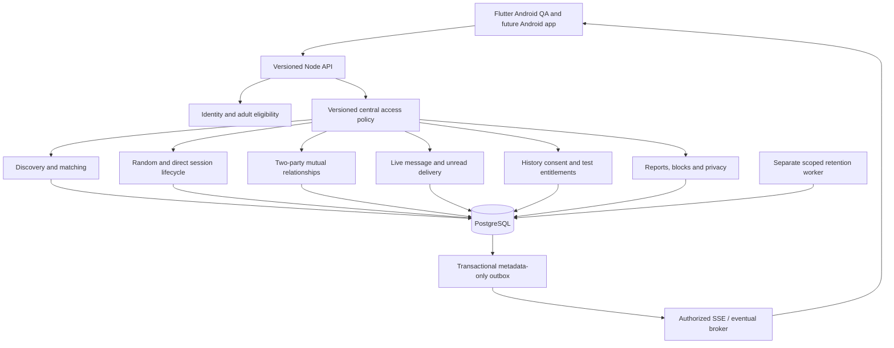

# Bridge Architecture V2 — approved design contract (not implemented)

**Document:** BRIDGE-ARCH-V2-20261115  
**Founder approval:** 2026-11-15, **FOR DOCUMENTATION AND IMPLEMENTATION PLANNING ONLY**  
**Verified source baseline:** `main` at `3578565aa5542a52fdc2679829db6f938cc960d3`  
**Governing policies:** [Product Invariants V1](../product/PRODUCT_INVARIANTS_V1.md) BR-001 through BR-029; D-01–D-07, H-01 and M-01 as approved.  
**Implementation:** NOT STARTED. **No migration, code edit, deploy, deletion, billing change, paid expense or release is authorized by this document.**

## Decision and architecture

Preserve the **Flutter Android + Node.js modular monolith + PostgreSQL** foundation and REST/SSE/outbox approach. Do **not** rebuild in NestJS, introduce Redis/microservices, or connect real payments without a separate evidence-based approval. PostgreSQL is the transaction source of truth, not Android state.

Components:

## Non-negotiable domain boundaries

1. **Random chat session:** immutable source session, `kind=random`; one active slot per account; server-controlled 30m idle expiry. Back/relogin may recover the *current unexpired* room, never ended/expired room or archive.
2. **Mutual relationship:** two independent valid Keep choices create a durable, revocable connection. Relationship is free, does not expire for inactivity, and contains no historical message body.
3. **Direct-chat session:** NEW conversation ID and message sequence for each new free mutual session, 30m accepted-message inactivity. One open direct segment per relationship; old source random ID is never used as a DM history handle.
4. **Unread delivery:** recipient-scoped 7-day maximum; acknowledgment and 15m bounded transport recovery, not unrestricted older-session pagination. Incoming messages remain deliverable after a sender's direct segment closes, without exposing that segment's transcript.
5. **Optional history:** new direct messages only, retained prospectively when BOTH participants held effective retention consent at acceptance; viewer additionally needs active server-side entitlement. 90-day rolling window. No random transcript copy or retroactive unlock.
6. **Restricted case evidence:** case-related encrypted/controlled evidence snapshot, separate from ordinary chat text, reviewer RBAC, purpose, audit, finite lifetime. Reporting/privacy rights never paid.

## State machines and races

### Random session

`idle -> waiting -> active_random -> ended | expired | safety_closed | converted`.

- Search waiting request remains a separate **120-second queue timeout**. The existing **60-second reservation lease** is not the active-chat inactivity clock.
- On activation, set `last_accepted_at = activated_at` and `idle_expires_at = activated_at + 30 minutes`.
- Only accepting a **new unique** `clientMessageId` resets idle deadline; idempotent retries never extend it.
- Keep pending is a **vote overlay** on the same still-live random room; not a new conversation state granting messaging.
- Check DB clock **inside transaction after acquiring locks**; `now >= idle_expires_at` means expiry wins, even if sweeper is late. Expiry closes room and releases match slots idempotently.
- Both votes processed transactionally before expiry create relationship and mark source `converted/closed`; do **not** mutate source `kind` to `connection`.
- User-End, block, sanction and expiry have stable terminal reasons; no resurrection.

### Direct session

`relationship_active -> direct_session_open -> segment_closed/idle_expired`, after which another `direct_session_open` can be started free if relationship is still active.

- Relationship withdrawal, block or eligibility failure prevents new sessions and revokes future live/unread/history access.
- A first newly accepted message may establish a direct session for an offline peer.
- No second concurrent live direct segment for the same relationship; use transactional locks and uniqueness.
- A closed direct segment is not free history; remaining recipient-scoped unreads can be consumed through a separately authorized delivery endpoint.

### Delivery and history

`accepted -> pending_unread -> presented -> acknowledged/consumed | expired/revoked`.

- Per-recipient envelope has a finite 7d clock and source message ID; delivery is idempotent.
- On first acknowledged presentation, client gets a **15-minute idempotent retry** capability for crash recovery, not a timeline cursor. Define retry token binding, expiry and replay resistance in the scoped PR contract.
- Both live and unread paths emit no message body via SSE hints or notifications. Bodies are fetched from independently authorized scoped stores.
- Deleting ordinary content must not stall ordered replay: use authorized checkpoint/tombstone protocol; no leakage of removed content.

## Central authorization

Every request: signed/revocable authenticated identity -> active account/appropriate adult eligibility -> server-owned session/relationship -> participant or restricted reviewer scope -> two-way blocks/sanctions -> authoritative clock/state -> payload-specific access contract -> entitlement/consent if HISTORY -> policy-versioned allow/deny with privacy-safe audit. Fail closed.

| Surface | Eligibility | Required authority | Maximum exposure |
|---|---|---|---|
| Discover/search | Adult eligible, not restricted | Own authenticated account, moderated shared language | Own queue/match state only |
| Random live send/read | Active unexpired session | Current participant, no blocks | Current session only |
| Keep | Same unexpired random room | Independent member vote | One pending vote cannot expose other member state |
| Mutual direct session | Active bilateral relationship | Own membership, no blocks | Current segment only, free |
| Unread envelope | Active bilateral relationship and intended recipient | Own authenticated recipient, valid 7d envelope | Single scoped unread; 15m transport retry |
| History | Active relationship, dual consent at message acceptance and now, viewer TEST/paid entitlement, 90d TTL | Server-minted history scope | Only prospectively retained direct messages |
| Post-end report | Reporter was participant; token up to 7d | Hashed opaque report token; no room reopening | Case intake and reporter-supplied details |
| Evidence | Restricted, approved case purpose and reviewer role | Audited case-specific RBAC | Minimum required case snapshot |
| Account export/delete | Authenticated user, required rights | Account owner and privacy process | Own lawful data; retention exceptions disclosed |
| Entitlement grant | QA admin only until purchase approval | Server-side audited issuance | Test environment only; never client writable |

**Old API bypass:** Existing `GET /v1/conversations/:id/messages?afterSequence=0` is broad historical replay for an active conversation. A V2 UI-only restriction is unsafe. After cutover, old API must enforce equivalent access restrictions or return safe upgrade/deny; never re-enable old unrestricted read during rollback. Do not distribute stale client builds that bypass V2 restrictions.

## Additive schema design (proposal, not migration)

Preserve existing `bridge_accounts`, profiles, blocks, languages, match queue/sessions/slots, conversations/participants, message IDs/sequence, votes, connections, reports, audit, outbox and privacy requests.

Proposed additive fields:
- `bridge_conversations`: immutable kind policy, `policy_version`, `connection_id`, `last_accepted_at`, `idle_expires_at`, `closed_reason`, `legacy_qa`; deprecate but don't drop direct body columns during expansion.
- `bridge_connections`: relationship independent of `source_conversation_id`; revocation and policy version; current direct-session exclusivity.
- Message metadata and body separated; metadata preserves sequence/idempotency while body has delete-after/scope and restricted encryption references.

Proposed new objects:
- `bridge_direct_session_lease` or equivalent partial unique session constraint.
- `bridge_message_payloads`, `bridge_unread_deliveries`.
- `bridge_history_consents`, `bridge_history_items`, `bridge_entitlement_grants`.
- `bridge_report_tokens`, `bridge_report_evidence`, `bridge_reviewer_access_audit`.
- `bridge_retention_jobs`, `bridge_policy_ledger`; session and privacy request status records as required.

Add foreign keys, partial uniqueness, non-null conditions and delete behavior incrementally. Precisely review `ON DELETE CASCADE` behavior around evidence and privacy requests. No `DROP`, `TRUNCATE`, `DELETE` or bulk expiry until separately approved. SQL schemas and migrations require disposable DB rehearsal and restore evidence.

## Data retention and privacy (approved planning defaults)

| Class | Duration / authorization |
|---|---|
| Random session | 30m idle, DB-authoritative; closed means **no** ordinary reading |
| Original random body | Purge ordinary storage **within 24h after end**; separate approved evidence/hold exceptions |
| Direct live segment | 30m idle; ordinary body removed within 24h after closure once independently authorized unread copies are safe |
| Unread direct envelope | **Up to 7 days** from message acceptance; 15m recovery after acknowledgment; must not become archive |
| Premium history | **90d rolling** per consent-eligible direct message; active viewer entitlement required; consent withdrawal immediate deny and purge queue within 24h except valid case/legal holds |
| Ended random report token | **7 days**; no ordinary body access and no claim deleted text remains |
| Normal case evidence | **90d after resolution/closure** |
| Serious/escalated/appealed evidence | **180d after closure** with documented review |
| Unresolved ordinary case | Need review every 30d, escalation review at 90d from creation, outside cap 180d absent formal reason/hold |
| Operational logs, backups, public identity | Separate legally reviewed schedules; do not equate chat-body limits with security log minimums |

Retention must distinguish (a) **immediate logical deny**, (b) **asynchronous physical removal**, and (c) **exceptional restricted evidence/legal hold**. Jobs are leased, bounded, retryable, idempotent; generate redacted audit and queue-lag alerts. Backup restores must reapply deletion ledgers before data becomes readable. Applicable jurisdictional duties need legal validation before public beta.

## QA-specific infrastructure and security

Current QA has two synthetic accounts, one random room, four messages and no mutual connections as verified by read-only audit on 2026-11-15. Do not reset or auto-expire them.

Neon inspection identity `neondb_owner` has `BYPASSRLS`, while 20 Bridge tables have RLS enabled but no `FORCE RLS`. This does NOT prove Render's runtime user has the same rights: verify connection principal safely before making any modifications. Separate migration owner, least-privilege app runtime, bounded retention worker, and reviewer role; test cross-account read isolation at API and SQL boundaries.

Remain on Render Free + Neon Free + single Node process for synthetic QA. Paid infrastructure, public authentication, production age assurance, moderator portal, push and billing each need later founder approval. Never treat cloud QA `age_verified_at` fixtures as real adult verification.

## Compatibility and rollout constraints

**Expand -> Rehearse -> Dual-write -> Safe-read cutover -> Device QA -> Dry-run retention -> Controlled retention -> later cleanup**.

- Version policy in DB and API. Keep old client working during early additive stages, but don't enable new privacy rules while old broad replay bypass remains reachable.
- Once history restrictions activate, rollback must be **safe deny** or reintroduce a forward-compatible patch; never roll back to unrestricted V1 history.
- Existing random session is an explicit `legacy_qa` exception only after separate migration approval; no retroactive 30m expiry/purge.
- No irreversible deletion or schema cleanup within first V2 rollout. Stage completion requires exact commit/DB migration evidence, negative authorization tests and founder/device PASS.
- A report snapshot mechanism must exist and be tested **before** live ordinary payload purging.

## Release and architecture decision boundary

The architecture is approved as a **design target**, not as production-grade functionality. The detailed [V2 implementation package roadmap](V2_IMPLEMENTATION_PACKAGES.md) is **PROPOSED FOR FOUNDER APPROVAL**. No new runtime, data, deployment, payment, subscription or release action is approved yet.

Further security / legal requirements before public use: production authentication and revocation, real adult eligibility, moderator workforce and audit, abuse defense, privacy rights processing, app-store and local legal review, accessibility and performance testing, operational alerting. No E2EE claim.

**Original architecture source:** Founder-approved 52 KB / 426-line `BRIDGE-ARCH-V2-20261115` approval draft supplied in conversation 2026-11-15. This repository document records its operationally relevant approved decisions and scope; it does not imply any implementation.
