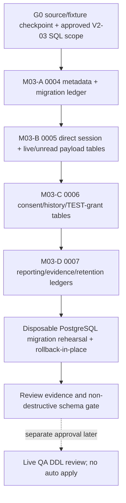

# Bridge V2-03 — Exact Additive Schema Implementation Brief

**Status:** PROPOSED FOR SEPARATE FOUNDER APPROVAL — DOCUMENTATION ONLY  
**Prepared:** 2026-11-16 · **Verified base:** `main@7721afbb608edcad2a71b888bcb90ec1fc251a1b`  
**Governing contracts:** [Approved V1 invariants](../product/PRODUCT_INVARIANTS_V1.md), [approved V2 architecture](ARCHITECTURE_V2.md), [delivery gates](V2_IMPLEMENTATION_PACKAGES.md), [V2-02 security review](V2_02_SECURITY_REVIEW.md).  
**Scope now:** Design, source inspection and documentation only. **No SQL migration files have been created or applied; no schema/data modification, deployment, payment, deletion or new cloud cost is authorized.**

## 1. Objective

Prepare a safe, **expand-only** PostgreSQL layout enabling the next stages to implement:

1. Server-owned 30-minute random/direct session clocks and permanent terminal reasons, with an explicit `legacy_qa` exception for the existing test conversation.
2. Two-party Keep creates a **relationship**, while later direct sessions have **separate conversation IDs**, not a converted original stranger transcript.
3. Separate *message metadata* from ordinary live body, 7-day recipient unread copies, 90-day jointly-consented future-history copies, and restricted report evidence.
4. Case-specific report access, privacy retention obligations, deletion manifest/ledger and audited server TEST grants.
5. Testable database constraints, RLS posture and migration/rollback gates without touching the current private QA environment.

This stage is for **table/column/index structure and isolated rehearsals**, not operational expiry, old API history cutover, test entitlement issuance, message copying, safety evidence snapshots or actual retention.

**Design principle:** introduce no DB-side trigger or default that can unexpectedly end the current open conversation, mutate original messages, or make new V2 data visible through legacy V1 endpoints.

## 2. Source-verified original schema and nonnegotiable compatibility

| Existing source (0001–0003) | Compatibility contract |
|---|---|
| `bridge_conversations.kind` enum is `random|connection`; `state` is `open|closed`; `match_session_id` is unique and nullable | **Do not alter old enum or rewrite old rows** in the first expansion. Use nullable V2 context metadata and a separate new direct-session record; initial new DIRECT may use a fresh `kind=connection` conversation with a V2 direct-session link. Review future enum evolution separately. |
| `bridge_messages.body text NOT NULL`, unique per `(conversation_id,sequence_number)` and `(conversation_id,sender_id,client_message_id)` | **Keep old non-null bodies and uniqueness intact in V2-03.** Build independent future payload tables without writing to them yet. A future V2 read cutover requires a separately approved NULL-body metadata transition; don't prematurely relax this contract. |
| `bridge_connections.source_conversation_id` is `NOT NULL UNIQUE`, `ended_at` controls active relationship; partial pair uniqueness index | Keep source pointer intact and immutable for legacy QA; future V2 connections may continue referencing the closed original random room while direct sessions get their own IDs. No backfill/copy of old messages. |
| Legacy `connections()` only lists rows whose source conversation remains `state='open'`, and returns `source_conversation_id` as chat ID | New V2 connections with **closed** original random sources will intentionally **not work in this old API** until its V2-specific relationship/direct-session read path is approved. Do not create active V2 relationship rows in private QA simply because schema exists; this is a strict V2-05/V2-11 compatibility gate. |
| `bridge_conversation_participants` and `bridge_messages` depend on conversation FKs; some related records use `ON DELETE CASCADE` | Never delete or cascade existing conversations during this phase. Future evidence and history tables should use explicit `RESTRICT` or carefully justified `SET NULL` FKs, not automatic destructive cascades. |
| `bridge_match_sessions.lease_expires_at` is reservation lease, not chat lifetime | New `idle_expires_at` on conversation, nullable for legacy. Do not derive a retroactive expiry from old reservation timestamps. |
| `bridge_event_outbox` stores body-free event metadata | Preserve legacy event keys and message sequence; new delivery must not expose body via notification events. |
| All 20 existing tables `ENABLE ROW LEVEL SECURITY` but no public policies | RLS enabled does not certify the actual connection role; **no role/grant changes** in V2-03. Test role separation in disposable DB and flag runtime verification before any live migration. |
| Existing 2 synthetic accounts, 1 open random chat, 4 messages, 2 active slots (last observed 2026-11-15) | Historical observation only, not a fresh DB audit. M-01 mandates exact preservation, no implicit timed expiry or auto-cleanup. |

## 3. Proposed new schema objects (14 tables; explicit responsibility)

**All new objects start unused by runtime and start with RLS enabled / no new public grants.** Names and columns are proposed, not committed SQL.

| New object | Minimal columns / constraints | Owner of actual behavior |
|---|---|---|
| `bridge_schema_migrations` | `version` PK, `checksum`, `applied_at`, `runner_id`; exact-checksum apply-once ledger | V2-03 disposable migration runner; live release later |
| `bridge_v2_direct_sessions` | `conversation_id` unique FK, `connection_id` FK, `state` open/closed, `opened_at`, `closed_at`, `policy_version`; partial unique `connection_id WHERE state='open'` | V2-05 |
| `bridge_message_payloads` | `message_id` unique FK, `conversation_id`, ciphertext `bytea`, opaque key reference, `scope='live'`, `expires_at`, `purged_at`; no plaintext echo in indexes/audit | V2-06, V2-08 |
| `bridge_unread_deliveries` | `message_id`, `connection_id`, `recipient_id`, scoped encrypted copy/reference, `accepted_at`, `expires_at`, `acknowledged_at`, hashed recovery token, `state`; UNIQUE `(message_id,recipient_id)` | V2-06 |
| `bridge_history_consents` | `connection_id`, `account_id`, `policy_version`, `effective_at`, `revoked_at`, evidence of disclosure version; uniqueness of active consent per actor/relationship/policy | V2-09 |
| `bridge_history_items` | `message_id`, `connection_id`, ciphertext/key reference, `policy_version`, `accepted_at`, `expires_at`, `purged_at`; unique message/policy scope; never stranger source body | V2-09 |
| `bridge_entitlement_grants` | `account_id`, `scope`, `issuer`, `environment='qa'`, `issued_at`, `expires_at`, `revoked_at`, audit event pointer; no client-write privilege | V2-09 |
| `bridge_report_tokens` | one-way token digest, `reporter_id`, `conversation_id`, `issued_at`, `expires_at`, `revoked_at`, access scope; 7d hard maximum enforced by server | V2-07 |
| `bridge_report_evidence` | `report_id`, `case_id` or same report ID, source message metadata, scoped ciphertext, key ref, `evidence_class`, `retention_until`, legal-hold reference; no implicit cascades | V2-07 |
| `bridge_case_grants` | `case_id`, `reviewer_subject`, scope, purpose, `issued_at`, `expires_at`, `revoked_at`; no wildcard access | V2-07 |
| `bridge_case_access_audit` | `case_id`, reviewer, action, redacted purpose, timestamp, decision; no message text | V2-07 |
| `bridge_retention_jobs` | target kind/id, required policy version, deadline, state, lease, attempts, legal-hold check marker, redacted error code | V2-08 (dry run), V2-12 (activation) |
| `bridge_deletion_ledger` | immutable target identity/hash, logical deny time, physical purge time, scope/policy version, non-content evidence of deletion; backup restore reconciliation | V2-12 |
| `bridge_policy_ledger` | policy ID/version, approved-at, effective-from, immutable checksum; no client-selectable downgrade | V2-02+ integration |

**Important design conditions requiring SQL review:**
- All account/connection/message/report FKs preserve the original row and **must not allow cascade deletion of safety records** by accident.
- Scoped ciphertext is not automatically encrypted merely because a `bytea` column exists. Keys, envelope encryption, KMS cost, reviewer access and backups are separately gated. **Do not claim at-rest content encryption or E2EE from an empty column.**
- The 7-day unread copy must have its own access lifetime independent of a live conversation body's 24-hour post-close cleanup. Merely referencing an already purged body would break offline delivery.
- Prospective history must use a separate consent-eligible copy made at message acceptance in a later approved backend stage, not a snapshot of earlier random messages.
- Retention and deletion ledger records are metadata without private message bodies; legal-hold semantics require further safety/legal validation.
- A `bridge_v2_direct_sessions` row can reference a fresh `bridge_conversations.kind='connection'` row without changing the original random row, while future code must prevent legacy endpoint reads of that row before safe cutover.
- Never silently backfill `bridge_conversations.legacy_qa` to false or `idle_expires_at` from old `created_at`; unknown legacy rows remain excluded from new expiry until explicitly classified.

## 4. Proposed additions to existing tables

| Object | New nullable metadata | How existing rows behave |
|---|---|---|
| `bridge_conversations` | `policy_version text`, `v2_session_role text`, `connection_id uuid`, `last_accepted_at timestamptz`, `idle_expires_at timestamptz`, `closed_reason text`, `legacy_qa boolean` | All nullable; existing rows unchanged, no backfill, expiry job disabled |
| `bridge_connections` | `policy_version text`, `revocation_reason text` | Legacy active relationships unchanged; `ended_at` remains authoritative |
| `bridge_messages` | `policy_version text`, `payload_scope text`, `content_purged_at timestamptz` | Existing non-null body, content and message id/sequence unchanged |
| `bridge_reports` | `policy_version text`, `evidence_status text` | Existing queued reports preserved |
| `bridge_privacy_requests` (optional) | separate status metadata only if absolutely required by policy | No silent mutation of old request records |

**No required default values on legacy rows.** Optional future checks and FKs are staged `NOT VALID` then validated on disposable DB and reviewed before live rollout. Avoid exposing a new table through automatically granted public/default privileges.

### Reserved out-of-scope transition: legacy message body

`bridge_messages.body text NOT NULL` cannot remain mandatory once a later V2 writer needs metadata-only rows. The future transition is **relaxation of the NOT NULL rule**, at a separately approved *V2-06/V2-11 data contract cutover*, after new scoped payloads are authoritative, all old endpoints are safe, and compatibility tests pass. This is a **non-destructive type of schema change, but NOT strictly additive**; therefore it must **not** be hidden inside V2-03. Never delete or rewrite current text during this schema stage.

## 5. Proposed migration boundaries and dependency order

Do not batch all objects into an unreviewable SQL file. Break V2-03 into narrowly staged, one-way **expand migrations** on disposable PostgreSQL; later live Neon DDL needs its own approval.

**M03-A (0004)**: migration ledger + nullable columns on legacy tables, including `legacy_qa` and `idle_expires_at`; no index scan on message bodies; no default-bulk backfill. Compatibility check original methods unaffected.

**M03-B (0005)**: direct sessions, ordinary scoped payload, unread delivery. Exclusive one-open-session index and uniqueness of per-recipient envelope, scoped FKs `RESTRICT`. No runtime consumer, no ciphertext encryption keys in migration.

**M03-C (0006)**: prospective consent, history items and audited TEST entitlements. No test grants issued; no premium purchases. Check uniqueness and time-order constraints.

**M03-D (0007)**: report token digest, restricted evidence, case grants/audit, retention job/deletion ledger/policy ledger. No worker schedule, deletion, or case evidence copied during migration.

**M03-E (verification-only):** disposable seeded fixture -> schema apply -> all old APIs/SQL tests -> unique/FK/RLS and privileges -> exact data checks -> `pg_dump`/restore rehearsal -> negative tests. New data tables remain empty until separate feature PRs.

Migration filenames are proposals. Multiple scripts **do not grant multiple permissions** to apply live schema; even disposable integration code is subject to a separate founder authorization for V2-03.

## 6. Migration runner / checksum and transaction requirements

- Each migration is registered once under a version and strong checksum; a second attempt with matching checksum returns an explicit **already applied/no-op** at the runner layer; differing checksum **blocks**.
- Do not rely on `CREATE TABLE IF NOT EXISTS` to mask schema drift. Test all intended columns, FK actions, index predicates and table grants explicitly.
- Use transactional `BEGIN/COMMIT` for ordinary additive DDL with strict `ON_ERROR_STOP`. For large production tables, plan lock timeouts and required `CREATE INDEX CONCURRENTLY` outside a transaction (and ensure runbook supports interrupted-index recovery).
- Apply in exact order `0001`->`0002`->`0003`->`0004`->`0005`->`0006`->`0007` on a disposable DB. Do not rerun the *raw 0001 SQL* to test idempotency; use versioned migration-ledger verification.
- No drop/truncate/delete/backfill of old rows. Do not change existing enum values, RLS grants, triggers or production current users.
- New FK/index constraints require equality and on-delete action tests, including `bridge_connections.source_conversation_id` and safety evidence.
- DB time is authoritative for deadlines in later feature code; this stage stores clocks but never starts a sweeper.

## 7. Required local/disposable PostgreSQL CI tests

**Environment gate:** only loopback PostgreSQL with an explicit dedicated test database `bridge_test`; refuse any other hostname/database in migration test helpers. Use PostgreSQL 16 existing GitHub Actions disposable service. Do not pass Neon/Render env vars.

| Test ID | Exact verification | Failure mode blocked |
|---|---|---|
| M03-01 | Fresh schema 0001–0007 applies cleanly in specified order | Broken FK/enum/version ordering |
| M03-02 | Original 20 tables and original columns still exist unchanged | Hidden destructive DDL |
| M03-03 | Seed two synthetic accounts, one active random conversation, four messages and two active slots *before* migration; exact counts and content hashes match *after* | Lost QA messages |
| M03-04 | No existing `kind`, `state`, `source_conversation_id`, sequence, vote or queue value changes | Silent conversion |
| M03-05 | Existing legacy conversation has `idle_expires_at=NULL` and `legacy_qa=NULL` until explicit future classification | Retroactive expiry |
| M03-06 | One active direct segment per connection; two closed segments permitted; FK mismatch/duplicate direct IDs fail | Double-session races |
| M03-07 | Unread envelope is unique per message/recipient, with valid recipient and connection links and bounded timestamp constraints | Duplicate/wrong deliveries |
| M03-08 | Consent/grants constraints reject invalid relation/actor scope, and no active grants appear by default | Spurious premium history |
| M03-09 | Evidence FK actions and case grants prevent uncontrolled cascade reads/deletes | Evidence loss or exposure |
| M03-10 | All new tables have RLS ENABLED, no public policies and no unaudited default public grants | Unauthorized direct SQL |
| M03-11 | Old `postgres.integration.test.mjs`, HTTP, matching, V2-01 contracts and V2-02 policy suites still pass | V1 private QA regression |
| M03-12 | Exact migration checksum second-run no-op; checksum mismatch blocked; partial attempt rolls back | Drift/partial DDL |
| M03-13 | Dump->restore into **another disposable** DB preserves both existing and empty V2 objects | Recovery uncertainty |
| M03-14 | Failed/paused migration leaves current rows untouched, and additive tables can remain inert | Unsafe rollback assumptions |
| M03-15 | No automatic new expiry, history, purge, report copy, entitlement assignment or SSE payload appears | Unapproved behavior |

**Evidence artifacts:** exact source SHA, full SQL checksum list, data count/hash manifest using **synthetic fixtures**, successful CI links, role/policy checks, backup/restore proof, index/lock notices and migration rollback notes. Avoid printing password hashes, raw message text, private content or actual QA account identifiers.

## 8. Allowed paths and PR boundaries for future founder approval

**Proposed V2-03 migration-code PR(s) ONLY after separate approval:**
- `database/migrations/0004_*.sql` through `0007_*.sql`, **only additive** and with migration ledger.
- `apps/api/tests/v2/migrations/*.test.mjs` for disposable PostgreSQL assertions (test-only).
- `scripts/db/v2-migrate-test.mjs` or equivalent **loopback-restricted** disposable-only migration runner, with checksum verification and explicit environment guard.
- `apps/api/package.json` test runner wiring only.
- `.github/workflows/foundation.yml` additive PostgreSQL job steps; preserve existing tests.
- `docs/engineering/V2_03_MIGRATION_EVIDENCE.md` for evidence and `docs/engineering/V2_03_IMPLEMENTATION_BRIEF.md` for decision record.

**Prohibited:** `apps/api/src/postgres.mjs`, `http.mjs`, `auth.mjs`, `start.mjs`, `live.mjs`, `apps/api/src/policy/**` policy rules, `apps/mobile/**`, cloud provider configuration, payment, any query against live Neon (including read-only role inspection without separate approval), legacy cleanup, backfill, account edits, service deploy or a scheduled retention worker.

**Suggested PR boundaries (if approved):** one well-reviewed V2-03 engineering branch may contain the four numbered migrations + tests, **provided** individual migration sections and review/evidence gates are independently inspectable. If scope proves too large, separate into M03-A/M03-B/M03-C/M03-D PRs; no silent enlargement.

## 9. Rollback, release gating and ownership

- **G03-A baseline:** latest SHA and exact checked-in SQL snapshots, existing R0 physical acceptance still OPEN. Mark no real-device QA PASS.
- **G03-B disposable rehearsal:** all M03-01–15 tests pass on a **throwaway database**, including a full restore and a post-apply regression. No data from real tester accounts copied to CI.
- **G03-C scope review:** only approved migration/tests/docs/CI paths; no production runtime change; all new tables unused.
- **G03-D live QA planning:** produce a *separate exact execution proposal*, schema diff, backup/restore evidence, role/grant inspection plan, lock impact and expected counts. **Founder must independently approve before any live Neon schema write**.
- **G03-E downstream activation:** V2-04/V2-05/V2-06 each require their own code approvals; schema existence alone is NOT permission to use or expose it.
- **Rollback before live migration:** revert branch/PR or delete the disposable test DB.
- **Rollback after approved live additive migration:** leave unused columns/tables in place and disable future unapproved V2 routes. Avoid destructive `DOWN` scripts. Reversing applied schema is not a routine operation.
- **After V2-11 privacy cutover:** never revert to old unrestricted `GET /v1/.../messages` to recover functionality.
- **After physical retention deletion (later V2-12):** no ordinary rollback is possible; requires a separately approved disaster recovery procedure with deletion-ledger replay.

**Ownership / professional review:** Backend architecture validates model identity and clocks; DBA validates FKs/index/locks/grants; security reviews RLS/evidence, encryption key handling and separate scopes; QA checks regression/fixtures/recovery; product validates free messaging/no history and legacy preservation; founder approves each irreversible or infrastructure-affecting boundary.

## 10. Open issues requiring explicit technical resolution BEFORE migration-code approval

1. **How should a direct V2 session be represented given the old `kind=random|connection` enum?** Recommendation: new conversation ID with `kind=connection` plus `v2_session_role='direct'` and junction row; source random row never converted. Do not change enum in the first migration.
2. **Should payload storage schema carry ciphertext, key ref, or only an opaque encrypted blob reference?** Recommendation: ciphertext bytea + key reference as a placeholder schema, but do **not** authorize an encryption service/KMS or claim encryption implemented. Confirm key-management design before any live content is stored.
3. **When may `bridge_messages.body` become nullable?** Recommendation: **not V2-03**. Defer separately gated transition to V2-06/V2-11 after all legacy free-history endpoints are safe.
4. **How are migrations tracked?** Recommendation: append-only version + checksum ledger; every duplicate or conflicting attempt is explicit and auditable.
5. **How will new tables prevent bypass via DB owner privileges?** Recommendation: RLS-enabled, no grants, production role review and staged least-privilege migration; do not assert Render current role from separate Neon inspection.

These are specific engineering choices within already approved business invariants; no additional paid service or product feature is proposed.

## 11. Next approval request

Approve **V2-03 disposable-only additive schema and migration test implementation** following this brief: numbered expand migrations, migration checksum runner restricted to local `bridge_test`, synthetic data preservation and PostgreSQL CI, with NO runtime API/client changes, no live Neon DDL/read, no existing-data mutation, no external billing, no deletions and no deployment.

If approved, prepare a dedicated engineering PR, run the full CI, inspect schema/FK/unique/RLS and regression evidence, and report. **Do not apply any migration to Neon until a distinct live-migration approval.** R0 physical Android acceptance remains OPEN, and the exhaustive What If? audit remains final V2-16.
