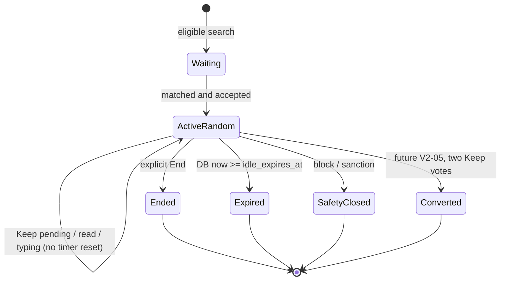

# Bridge V2-04 — Random Session Expiry & Slot-Safe Cleanup: implementation approval brief

**Status:** PROPOSED FOR SEPARATE FOUNDER APPROVAL — DOCUMENTATION ONLY  
**Prepared:** 2026-11-16  
**Verified baseline:** `main@a922f63d572866d751b9747070381c453e239026` (V2-03 disposable schema PR #20 merged and post-merge CI passed).  
**Approval authority:** [Product Invariants V1](../product/PRODUCT_INVARIANTS_V1.md) BR-003–BR-008, BR-012–BR-014, BR-019–BR-026 and D-01; [Architecture V2](ARCHITECTURE_V2.md), [implementation packages](V2_IMPLEMENTATION_PACKAGES.md).  
**Previous stages:** V2-01 reference contracts, V2-02 disconnected policy kernel, V2-03 additive SQL 0004–0007 plus disposable PG16 CI are IMPLEMENTED/CI TESTED. **0004–0007 have NOT been applied to live Neon.**  
**Operator device gate:** R0 Android phone/tablet acceptance remains OPEN. V2-16 comprehensive What If? audit remains at the end of the roadmap. Critical V2-04 expiry/safety cases cannot be deferred to V2-16.

## 1. Outcome and restricted authorization

Design an **isolated, production-intended but initially unconnected** random-session lifecycle component against the existing approved V2 schema, verified with disposable PostgreSQL. A future founder authorization is required before writing code in this package; a further, independent authorization is required before any Neon DDL/legacy-state reclassification, wiring into the currently hosted Node API, Render deployment or Android rollout.

The V2-04 contract is: a random conversation starts its inactivity clock on server acceptance of the match, expires **at or after** 30 minutes since activation or the last **new uniquely accepted** message, cannot be revived by Back, Keep, viewing, polling, reconnect or retries, and releases both matching slots **atomically** with its terminal transition. Expiry must remain enforced even if an optional sweeper is paused or never runs. Existing R0 synthetic chat/message data must survive unchanged.

V2-04 must NOT introduce mutual Keep conversion or create a direct-chat session (V2-05), a new unread/history body protocol (V2-06/09/11), post-end report evidence snapshot (V2-07), real purging (V2-12), public registration or live traffic.

## 2. Evidence-based assessment of existing source

| Current location | Verified behavior | Required V2-04 design |
|---|---|---|
| `apps/api/src/postgres.mjs::enqueue()` | Uses transaction and global `MATCH_MUTEX_ID=714411`; on match inserts `bridge_match_sessions` with `activated_at=now()`, two unique `bridge_active_match_slots`, then an OPEN random conversation without V2 expiry metadata | Future activation adapter must write `last_accepted_at`, `idle_expires_at`, `policy_version`, `v2_session_role='random'`, `legacy_qa=false` **atomically**, but NO V1 code edits in first V2-04 PR |
| `::participants()` | Locks conversation row `FOR UPDATE` and checks membership/block; no V2 idle clock | New repo adapter reads/locks **that same conversation row** and evaluates authoritative time **after lock**, to serialize send/expiry/End/Keep |
| `::sendMessage()` | Dedupes `(conversation_id,sender_id,client_message_id)`, increments sequence and inserts body-free outbox record on first acceptance; no expiry check or idle reset | V2 acceptance must check deadline before any new write, update deadline ONLY on a newly accepted unique message; duplicate retry cannot extend clock/outbox |
| `::messages()`, `::conversationPeer()`, `::authorizeEvents()` | Member/room checks but expired random session may appear open indefinitely | Later route cutover must validate clock at every live read, SSE authorization/replay and peer disclosure; old V1 route is an unresolved privacy bypass until V2-11 |
| `::bootstrap()` and `::queueStatus()` | Current open random session resolved from active slot; queue `reserved` is interpreted as connected without a V2 deadline check | Return Resume **only** for active, unexpired, V2-authorized room; expiry must not accidentally expose previous chat; queue state must reflect terminal outcome in later API integration |
| `::closeConversation()` | Closes random row, marks match ended, deletes slots, cancels attached queue rows | Share a single terminal-closure transaction with expiry; terminal reason must be recorded, repeated closure idempotent and slots released once |
| `::castVote()` | Existing V1 converts random conversation `kind` in place after dual Keep | New V2 session API must deny Keep at expiry; **actual V2 two-vote conversion belongs to V2-05**. Do not reuse V1 mutation for V2 rooms |
| `::block()` | Takes matching advisory lock and closes shared rooms, match slots and mutual relationships | Define lock-order and terminal precedence with block so blocked pairs cannot get stale room privileges |
| `apps/api/src/live.mjs` | Body-free SSE hints, calls supplied authorization before publication and heartbeat; no V2 session clock yet | New session expiry must be reflected through a future authorized SSE adapter; **do not** modify live hub in inactive V2-04 PR |
| `database/migrations/0001_bridge_foundation.sql` | `bridge_conversations.state` enum supports only `open|closed`; `bridge_match_sessions.state` supports `reserved|active|ended|expired` | Represent terminal state as `conversation.state='closed'` + `closed_reason='expired'|'ended'|'safety_closed'`; match state `expired` for expiry, `ended` for End/block, without enum migrations |
| `database/migrations/0004_v2_metadata.sql` | Adds nullable `last_accepted_at`, `idle_expires_at`, `v2_session_role`, `policy_version`, `closed_reason`, `legacy_qa` and clock consistency CHECK | These columns already exist **only in source and disposable CI**; no live Neon application allowed. NULL legacy clocks remain grandfathered/unknown, never auto-expired |

**Important:** Current `bridge_messages.body NOT NULL` stays unchanged in V2-04; this stage may test idempotent accepts against the legacy synthetic text column but may not introduce actual scoped body/history API. The V1 `connections()` endpoint also depends on the source room staying open, so no V2 Keep/conversion activation now.

## 3. Precise proposed first implementation PR: disconnected session engine

**Suggested title:** `V2-04A: isolated random expiry engine and disposable PostgreSQL race tests`.

**Allowed after separate founder approval** (no current authorization for these edits):

| File area | Proposed implementation | Restriction |
|---|---|---|
| `apps/api/src/sessions/clock.mjs` | Pure 30-minute window, terminal status and deadline predicates with stable V2 codes | No Date.now() or device-time authorization |
| `apps/api/src/sessions/random_lifecycle.mjs` | Domain-level `activate/authorizeCurrent/acceptUnique/expire/end` contracts using injected transactional DB adapter | No HTTP exports, direct-session logic or history/premium handling |
| `apps/api/src/sessions/random_repository.mjs` | Isolated PostgreSQL adapter: lock conversation, capture DB clock, compare deadline, idempotently transition terminal room/match/slots/queue in same transaction | Only disposable PostgreSQL tests; no production module imports this adapter |
| `apps/api/tests/v2/sessions/*.test.mjs` | Positive/negative and deterministic clock tests; real PG16 lock/race tests using fresh synthetic accounts | Refuse any DB URL except loopback `bridge_test`; no Neon connections |
| `apps/api/package.json` | Named `test:v2:sessions` test script | No runtime start/dependency change |
| `.github/workflows/foundation.yml` | Add V2-04 session job/step to existing disposable PG16 workflow after checked-in 0001–0007 | Preserve current matching, API, V2-01–03 and backup/restore checks |
| `docs/engineering/V2_04_SESSION_EVIDENCE.md` | SQL assertion mapping, state machine, race schedule, CI SHA and known unintegrated runtime gates | Do not claim physical-device or live Neon enforcement |

**Explicitly forbidden:** modifications to existing `apps/api/src/postgres.mjs`, `http.mjs`, `auth.mjs`, `start.mjs`, `live.mjs`, `outbox.mjs`, `apps/api/src/policy/**`, Flutter code, any SQL migration 0001–0007, added migration or live DB/user-data write; no cloud service deployment, sweeper scheduling, automated purge, billing, payments or public beta.

**Why disconnected first:** The current hosted Neon database has no V2-03 fields; a new module wired into the existing API would break the private tester baseline. SQL-enforced V2 features become available only after a separately approved live migration, a legacy-room classification and an explicit staged route-cutover PR.

## 4. Runtime contract for a later separately approved activation phase (NOT this PR)

1. **Create V2 random room:** match locks and slot ownership are checked. New V2 conversation insert explicitly sets `kind='random'`, `state='open'`, `policy_version='bridge-v2'`, `v2_session_role='random'`, `legacy_qa=false`, `last_accepted_at=acceptedAt`, `idle_expires_at=acceptedAt + interval '30 minutes'`; `bridge_match_sessions.activated_at` uses the same captured server instant. No historical row updated.
2. **Identify applicable room:** only explicitly V2-marked random rooms (`legacy_qa IS FALSE`, correct policy and role, both deadline columns present) use the expiry engine. Null/unknown legacy rows must not be reinterpreted as V2 by default. Unknown newly marked V2 clock => **DENY** rather than guessing/backfilling.
3. **Authorize current access:** validate server-authenticated account, both participants and no bilateral block, current room state and fixed deadline. On `now >= idle_expires_at`, deny LIVE send/read, Keep and SSE; no old/history fallback.
4. **New accepted message:** lock conversation, get fresh authoritative database instant after lock, test expiry, check idempotency key and participant/peer validity, insert message+sequence+body-free outbox, and update `last_accepted_at`, `idle_expires_at` from the **same** accepted instant in one commit. A duplicate key returns only an authorized, privacy-safe receipt while unexpired; never creates another outbox row or resets the clock. A conflicting duplicate body gets 409 and no clock reset. After expiry do not send historical body/receipt as a backdoor.
5. **Explicit End:** close exactly once using stable terminal `closed_reason='ended'`, set `closed_at`, mark match `ended`, remove **both** slots by match ID and cancel **only** queue rows associated with that match. Never cancel a newly created unrelated search.
6. **Expire:** same shared terminal helper, `closed_reason='expired'`, match `state='expired'`, all in one transaction. Expiry cannot race to overwrite an already committed End/Block/converted state.
7. **Block/safety:** barrier before continuing chat; shared terminal closes as `safety_closed` when appropriate. Block's broader relationship revocation and safety case intake remain separately owned; a late V2 expiry cannot undo an active block or create contact.
8. **Restart/Back/Resume:** client location/background is irrelevant; bootstrap must return only an unexpired current room, and no report token or previous-message history. Expired room may have uncollected slots until cleanup; matcher must trigger a safe, transactional expire-and-release before treating slots as active **when authorized later**.
9. **Sweeper:** optional bounded batch of explicitly V2-marked expired rooms, no scanning/expiring null legacy clocks, disabled by default, no worker started/deployed in first implementation PR. Every protected read/write must enforce deadlines **without** it.
10. **Keep conversion:** not yet implemented. V2-04 must provide a terminal-transaction boundary that V2-05 can reuse, but **must not convert** source random `kind` or create a mutual relationship. Keep overlay cannot extend deadline.

### Time correctness: do not use PostgreSQL `now()` for a post-lock expiry decision

PostgreSQL 16 documents that `now()`/`transaction_timestamp()` are anchored to the **start of the transaction**; a transaction waiting on a locked row may therefore compare against an earlier time and incorrectly accept a message after expiry. Use a fresh `SELECT clock_timestamp()` **after acquiring the relevant row/advisory locks**, bind that single value into expiry checks and updated timestamps, and confirm boundary behavior under lock contention. **Do not sample the deadline before waiting for the lock.**

Reference: [PostgreSQL 16 date/time functions](https://www.postgresql.org/docs/16/functions-datetime.html). The final transactional design also needs to define the accepted timestamp and guard against a long pause between that timestamp and COMMIT; testing must include a deliberately held transaction across the boundary. Neither Android nor HTTP-request start time is authoritative.

## 5. Transaction and lock order

**Candidate lock order for V2 random lifecycle** (must be verified against current match/block code before live integration):
1. Transaction-level matching advisory mutex for actions that alter matching slots/queue or close random rooms, using the existing `MATCH_MUTEX_ID` only after a reviewed compatibility test; avoid deadlocks by using consistent ordering everywhere.
2. Matching pair/account locks where required by the operation.
3. `bridge_conversations` row `FOR UPDATE` (mutual send/End/expiry/Keep serialization).
4. Match-session row `FOR UPDATE`, then match slots/queue rows in consistent indexed account ordering.
5. Capture one **fresh DB clock after locks** before deciding acceptance or terminal reason; write entire terminal state and outbox in one commit.

**Caution:** Existing `participants()` locks the conversation before other mutations whereas `block()` begins with the matching advisory lock. Inconsistent acquisition order between legacy and new callers could deadlock. The disconnected adapter should prove a consistent lock order against a synthetic V2-only harness and document the exact required integration adjustments for a later founder-approved PR. A global mutex is expedient for two testers, but it is not a scalable final design; concurrency/lock duration is measurable in CI.

**Competing writes:** a unique accepted message committed before the deadline extends it; a later End, Block or expiry closes it. A send that waits until after deadline must fail without extending, even if its HTTP request arrived before expiry. Repeated End/Expire attempts produce the same terminal outcome without a partial slot orphan. If a terminal reason already exists, never change it merely because another worker arrives later.

## 6. State machine and behavior semantics

In storage, `bridge_conversations.state` still has only `open|closed`, and the terminal reason is `closed_reason`; `bridge_match_sessions.state` has `expired|ended`. This diagram is a domain model, not new PostgreSQL enum values.

**Mutual relationship and future direct-chat session timeouts are separate later-stage domains.** V2-04 expiry must not end a saved mutual relationship. Android UI may eventually display a remaining-time indicator, but no frontend change is approved within this stage.

## 7. Exact acceptance matrix: proposed tests R04-01 through R04-24

| ID | Test and expected result |
|---|---|
| R04-01 | New explicitly V2-marked room has matching activation, last-accepted and expiry (+30m) from the SAME database instant |
| R04-02 | At last accepted +29m59s (and sub-second boundary), authorized random LIVE is permitted |
| R04-03 | At exactly +30m, random LIVE read, send and Keep deny; expiration still enforced when worker is stopped |
| R04-04 | New **unique** accepted message at 29:59 extends last-accepted and expiry atomically |
| R04-05 | Idempotent same-key/same-body retry produces one message/outbox and **no timer reset** |
| R04-06 | Same key with different body returns conflict; clock/sequence/outbox unchanged |
| R04-07 | Typing, Keep pending, read, poll, SSE heartbeat, reconnect and notifications never extend clock |
| R04-08 | Process/app restart with an unexpired current room keeps same authorized room ID, no duplicate slot |
| R04-09 | Room returned after 35m has expired, no Resume/history; account authentication clock remains independent |
| R04-10 | End closes conversation and match atomically, deletes BOTH slots and only its associated queued rows |
| R04-11 | Repeated End/Expire is idempotent; already terminal reason is preserved |
| R04-12 | Expire vs send locks: if send obtains lock before deadline it may win; if waits past deadline it fails |
| R04-13 | Expire vs Keep: late second vote cannot create connection; **conversion tests owned by V2-05** |
| R04-14 | Expire vs block/safety closure: block prevails as appropriate and cannot be undone by expiry |
| R04-15 | Simultaneous 2-device End/Expire produces one terminal result and no orphan slots |
| R04-16 | Expiry of room A cannot cancel room B's new queue/match; only match-ID-scoped cleanup |
| R04-17 | Null-clock legacy room and four synthetic messages untouched; legacy match remains active in test fixture |
| R04-18 | V2-marked room missing clock/policy facts **fails closed**; does NOT silently become a legacy exemption |
| R04-19 | Caller guessing unrelated conversation or acting as outsider cannot access metadata or mutate terminal state |
| R04-20 | Two-way block, ineligible peer or revoked participant cannot send, resume or consume events |
| R04-21 | Optional sweeper **disabled**: on-demand expiry/authorization still correct; worker never required for denial |
| R04-22 | Failure injection between close-room, match-status, slot-removal and queue cleanup rolls back ENTIRE transaction |
| R04-23 | V1 existing API and V2-01/02/03 contract/regression suites remain green on disposable PG16 |
| R04-24 | No new route, Render deployment, Neon read/DDL, real QA state change, billing or client behavior in implementation PR |

**Extra mandatory precision tests:** lock held across expiry; server clock vs client clock skew; stored timestamp rounding; absent sweeper; stale V1 body-reader after room expiry; closed-room guessed ID; idempotent retry after expiry must not leak body; concurrency retry with unique sender+client UUID; malformed V2 marker.

## 8. CI and evidence requirements

**G04-A — Scope check:** branch originates from current verified main. Only approved new `apps/api/src/sessions/**`, synthetic `apps/api/tests/v2/sessions/**`, named test script/CI and `docs/engineering/V2_04_SESSION_EVIDENCE.md`. Existing `apps/api/src/postgres.mjs`, `http.mjs`, V1 routes, SQL 0001–0007 and Flutter remain unchanged.

**G04-B — Pure and disposable PG16:** run strict random-state tests with a deterministic fake clock for pure helpers; run true transaction/locking/row/FK tests with PostgreSQL `clock_timestamp()` on loopback `bridge_test` after checked-in migrations 0001–0007. Prove concurrent send/End/expire with multiple SQL clients and force rollback at injected failure points.

**G04-C — Legacy invariants:** preserve two synthetic accounts/four original messages/two original active match slots in a before/after hash manifest. No automatic reclassification, expiry, purge, Keep conversion or message history copy.

**G04-D — Existing CI:** matching, backend HTTP/auth and PostgreSQL integration, V2-01 contract, V2-02 actual policy kernel, V2-03 migration/restore remain green. No paid test provider, no external DB credentials, no new runtime dependency.

**G04-E — QA boundaries:** optional sweeper defaults OFF, feature flag/new adapter not imported into current startup, no use of Neon connection details. A green module test means **V2-04 ENGINE IMPLEMENTED / DISPOSABLE CI VERIFIED / LIVE ENFORCEMENT NOT ACTIVATED**, never user-visible expiry or device PASS.

**G04-F — Governance:** PR is reviewable and rollback-ready; if a check fails, do not merge. R0 physical device acceptance remains OPEN. Report any source-schema incompatibility rather than altering a migration silently.

## 9. Risk and rollback matrix

| Risk | Prevention / stop | Rollback |
|---|---|---|
| Existing QA random chat expires without permission | V2 marker + explicit `legacy_qa IS FALSE` + no production wiring; all old rows untouched | Revert isolated code PR; no live effects |
| Expired chat still blocks rematching due to slots | Atomic terminal + scoped slot removal; future matcher lazily expires owned rooms before new search | Safe deny/no new match until fixed; never delete arbitrary slots |
| Message accepted after expiry because stale `now()` | Fresh DB clock after lock, boundary tests including long transaction hold | Stop CI; correct adapter before integration |
| Keep converts old random transcript | No V2 Keep conversion in V2-04; V2-05 separate PR | Do not transform source; no live enable |
| Unrestricted V1 message replay after V2 clock activation | Defer V2 activation until server routes enforce expiry/scopes, including old API and SSE | Safe deny new path; never resurrect unrestricted V1 history after privacy cutover |
| Send/expiry/block deadlock | Deterministic lock order, concurrency tests, lock timeouts and bounded retries | Leave new adapter inactive and fix concurrency |
| Expiry worker crashes or is disabled | Read-time/commit-time authority; worker optional | No special rollback needed |
| Unexpected Neon roles/schema or DDL not applied | No live migration or connection in V2-04 PR | Keep private QA untouched |
| User data loss through cleanup/cascade | Delete only active slot/queue association of terminal match; no message/conversation DELETE or ordinary body purge | Stop and repair isolated test; live rollback not authorized |
| High lock contention on one global mutex | Record hold times and affected concurrent operations; future finer-grained design needs approval | Disable adapter before wiring; no cloud cost |

## 10. Two distinct approvals still required

**Approval A — first code package (next decision):** Authorize only the **disconnected V2-04 random lifecycle module**, pure tests, synthetic/disposable PG16 race tests, test-only CI runner and evidence document. No existing live API or SQL migrations, even read-only Neon access, no cloud service, no Android or paid service. After CI, the engine may be merged as **inactive source**.

**Approval B — later LIVE ACTIVATION (NOT part of Approval A):** Independently review and approve a safe migration of 0004–0007 on Neon, source-account/legacy classification, real V2 matching/send/bootstrap/Keep/End and old-history endpoint guards, rollback and actual Render deployment. That phase must reconcile dependencies with V2-05/V2-06/V2-11 and R0 physical-device evidence; it cannot be enabled merely because V2-04's isolated adapter passed CI.

## 11. Founder decision request and next handoff

Approve the **V2-04A implementation scope only**, using this exact brief: new `apps/api/src/sessions/**` code disconnected from live services, synthetic-only PostgreSQL 16 tests, deterministic clocks, named test script, isolated CI and evidence. Keep `legacy_qa` untouched, optional sweeper OFF, R0 physical acceptance OPEN and entire 138-case What If? review at final V2-16. No migrations against Neon, no current API/Flutter edits, no deployment, no billing, no retention/delete actions.

Once authorized, implement V2-04A in a separate engineering PR, run test/race/preservation CI and provide objective results. Do **not** begin V2-05 or any live activation from this authorization.