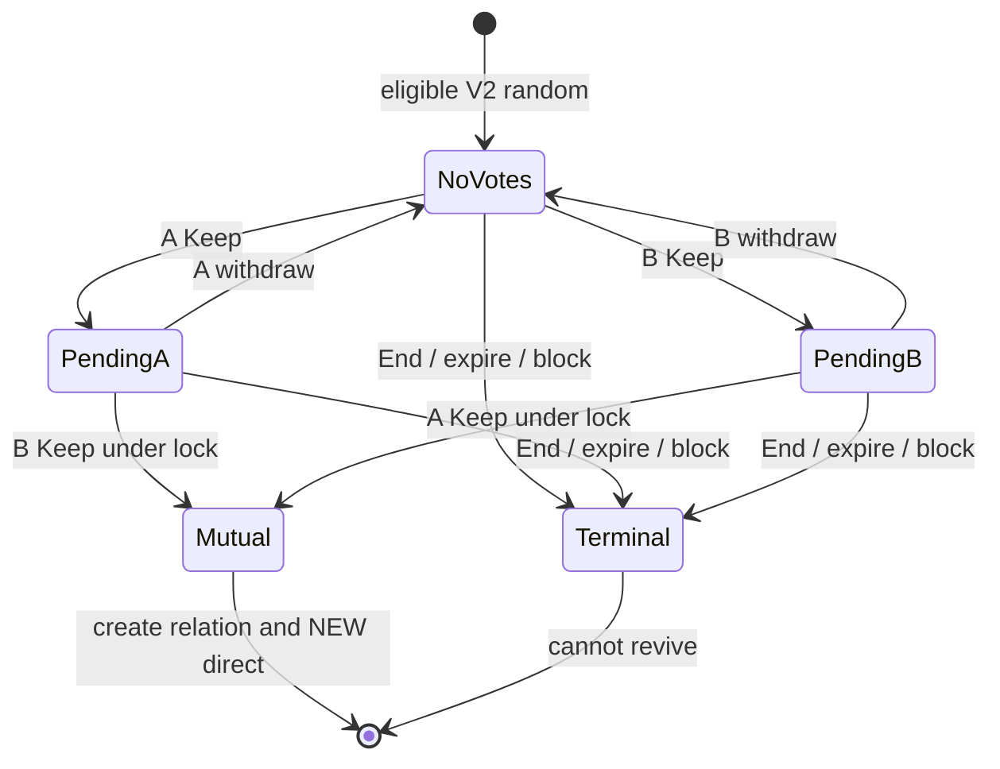
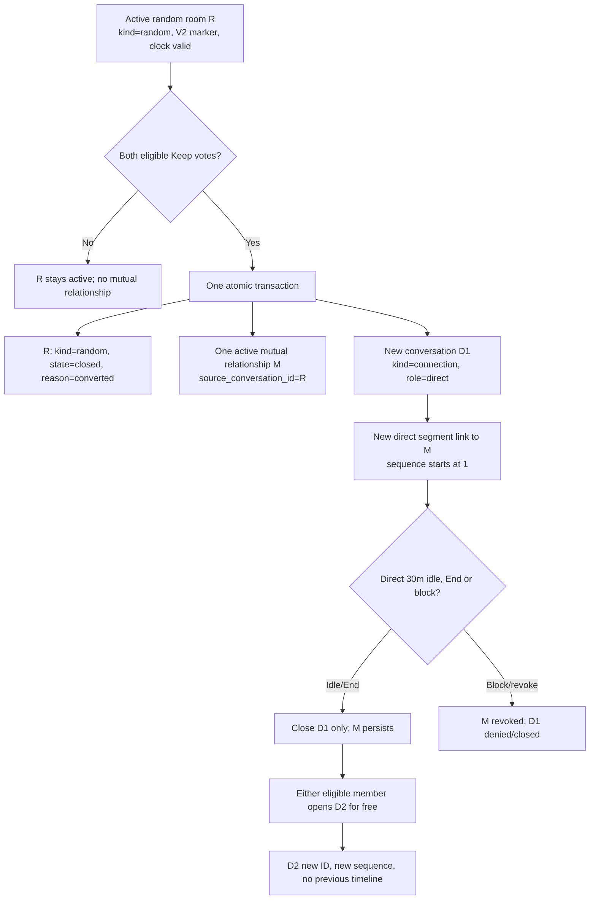
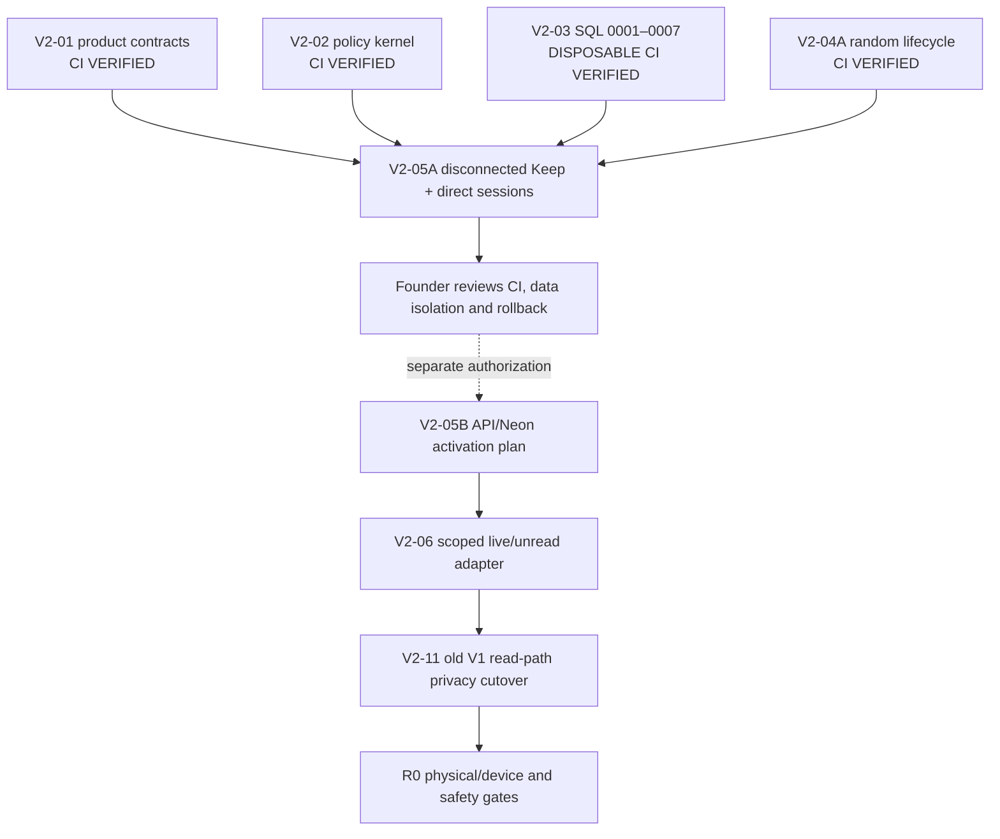

# Bridge V2-05 — Immutable Random Source, Mutual Keep & Free Direct Sessions

**Status:** PROPOSED FOR SEPARATE FOUNDER APPROVAL — DOCUMENTATION ONLY  
**Prepared:** 2026-11-16  
**Verified repository baseline:** `main@1ef086c6e4b87ad966b103db33872513f7ae6bda`, V2-04A PR #22 merged and [post-merge CI passed](https://github.com/rayadinaveen98-ship-it/bridge/actions/runs/43811015419).  
**Authority:** [Approved Product Invariants V1](../product/PRODUCT_INVARIANTS_V1.md) BR-003–BR-014, BR-017–BR-020, BR-024–BR-029, D-01–D-04, D-06a/D-06b, M-01; [Architecture V2](ARCHITECTURE_V2.md); [V2 packages](V2_IMPLEMENTATION_PACKAGES.md); [V2-04A evidence](V2_04_SESSION_EVIDENCE.md).  
**Authorization now:** Investigation and documentation **only**. Do not modify application code, SQL migrations, Neon/schema/roles/data, Render, Android, billing, payment, retention, test credentials or public beta.

## 1. Product outcome — exactly what mutual Keep means

Bridge is an adult-only pseudonymous product, with two distinct ways of talking:

- **Random room:** an expiring temporary stranger conversation with its own original source ID and message stream. Unilateral Keep only records that one participant is interested. No old content is carried into any new relationship.
- **Mutual relationship:** only two valid, current, independent Keep votes establish one revocable link between the same two eligible accounts. A relationship persists **until ended/blocked**, even when no chat session is open. It **never** grants access to earlier random messages.
- **Direct session:** an independently timed, **free** 30-minute idle message segment under the active relationship, with a **new conversation ID** and sequence starting at 1. After the segment ends, a participant may open another free segment while both remain eligible and unblocked. The older direct segment is **not** a free message-history timeline.

A user's prior Keep alone must not produce a contact, a permanent room, offline delivery, paid entitlement, or a message-history grant. Future consented history is a separate V2-09 permission and storage scope; unread delivery is V2-06, never a generic archive.

## 2. Verified implementation gaps from current `main`

| Verified code/schema | Existing behavior | V2-05 implication |
|---|---|---|
| `apps/api/src/postgres.mjs::castVote()` | Takes existing `participants()` row lock, writes `bridge_connection_votes`, and on two accepts inserts `bridge_connections` then **updates original `bridge_conversations.kind='connection', state='open', closed_at=NULL`** | **Forbidden for V2 rooms**: must instead leave original `kind='random'`, close source with `closed_reason='converted'`, create separate relationship and new empty direct room |
| `::connections()` | Joins `bridge_connections.source_conversation_id` to original room; returns connection only if original conversation `state='open'`; returns source ID as `conversationId` | New V2 source will be **closed**, so **legacy list is incompatible**. No new V2 relation may be exposed through or "fixed" by returning old source; V2 relation-list read path needs separately approved safe cutover |
| `::sendMessage()`, `::messages()` and SSE | Generic kind/open checks and body replay; `bridge_messages.body NOT NULL` | New V2 direct room would be unsafe if legacy generic readers can use its ID; no V2 room activation until V2-06/V2-11 safe live/UNREAD authorization replaces V1 replay |
| `::block()` | Takes global match advisory lock, ends pair's rooms and active relationships | V2 Keep/direct transactions must serialize against block and prevent stale Keep from reviving any terminated relationship |
| `database/migrations/0001_bridge_foundation.sql` | Two votes per random room (unique per voter); `bridge_connections.source_conversation_id UNIQUE NOT NULL`; partial unique active pair; conversation kind `random|connection` and state `open|closed` | Existing constraints are useful: source remains intact, one active pair, no enum/schema rewrite needed in V2-05 |
| `database/migrations/0004_v2_metadata.sql` | Nullable `policy_version`, `v2_session_role`, `connection_id`, `last_accepted_at`, `idle_expires_at`, `closed_reason`, `legacy_qa` | Explicit V2 markers required. Legacy NULL markers are never an invitation to mutate QA fixtures |
| `database/migrations/0005_v2_delivery.sql` | `bridge_v2_direct_sessions` links new conversation and relationship; **one OPEN direct session per connection** unique index | Use this junction for session exclusivity; represent fresh direct room as `bridge_conversations.kind='connection', v2_session_role='direct'` with new ID; no direct room source-content copy |
| `apps/api/src/sessions/random_repository.mjs` (V2-04A) | Disconnected typed V2 source guard, shared `MATCH_MUTEX_ID=714411`, fresh DB `clock_timestamp()` after locking; closure atomically ends match and releases its slots | V2-05 implementation must coordinate **under the same database transaction and lock order** with source closure. Calling V2-04A `close()` separately would make Keep conversion **non-atomic**, so do NOT do that |
| `apps/api/src/policy/**` | Disconnected pure evaluator can identify separate random, direct, connection operations | Not wired into existing API. Only trusted DB-derived context may be passed during a later separately approved integration |

**R0 note:** Existing private synthetic QA room/four messages are preserved and must remain operational as their **original V1 baseline**. V2-03 SQL is tested/committed source but **not applied to Neon**. Do not call V2-05 "live" because disconnected PG16 tests pass.

## 3. Explicit V2-05A code package for separate founder authorization

**Recommended first engineering PR:** `V2-05A: disconnected mutual Keep and free direct-session engine`.

Build an internal, transactionally complete PostgreSQL domain adapter for V2-marked rooms, without importing it from the existing `http.mjs`, `postgres.mjs` or Render startup. Reuse the **existing SQL schema 0001–0007** on local `bridge_test`; all mutations are to randomly generated **synthetic disposable rows only**.

| Proposed permitted path | Proposed change | Exclusions |
|---|---|---|
| `apps/api/src/connections/keep.mjs` | Pure accepted/withdrawn, one-sided/two-sided and terminal vote-state validation | No new HTTP routes or client-supplied authorization shortcuts |
| `apps/api/src/connections/keep_repository.mjs` | Isolated transaction for valid Keep/withdraw, source close as converted, exactly one mutual relationship, first empty direct segment and match slot cleanup | Must never rewrite random `kind`, move/copy messages, activate on Neon or call V2-04A close in a separate transaction |
| `apps/api/src/sessions/direct_lifecycle.mjs` | Pure 30-minute direct-session idle semantics, connection vs session lifetime and finite state contracts | Does not implement messaging body, unread queue or premium history |
| `apps/api/src/sessions/direct_repository.mjs` | Standalone create/resume/close/reopen for fresh direct sessions, connection/participant/block/eligibility checks and one-open uniqueness | No actual direct message send/replay, app UI or retention worker |
| `apps/api/tests/v2/connections/**` | Real DB duplicate voting/withdraw race, Keep vs End/Expire/Block, immutable source, free relationship, negative ownership | **Disposable PostgreSQL only**, synthetic users |
| `apps/api/tests/v2/direct/**` | Fresh direct sequence, 30min deadline, same relation across sessions, free reopen, two simultaneous opens, revoked relation denial | Do not assume V2-06 actual delivery/history implemented |
| `apps/api/package.json` | Explicit test-only `test:v2:connections`, `test:v2:direct` | No change to `start`, dependency install or runtime env |
| `.github/workflows/foundation.yml` | Extra tests inside existing disposable PostgreSQL 16 workflow after migrations 0001–0007 and prior API regression suite | No new hosted service, cloud secret, migration deploy or paid CI service |
| `docs/engineering/V2_05_EVIDENCE.md` | CI evidence, traceability and remaining activation gaps | No claim of live API enforcement |

**Prohibited paths/actions:** any changes to existing `apps/api/src/postgres.mjs`, `http.mjs`, `auth.mjs`, `start.mjs`, `live.mjs`, `outbox.mjs`, `apps/api/src/policy/**`, all `database/migrations/0001–0007`, Flutter Android/mobile, hosted Neon or Render, test identities/messages, retention deletes, billing/payment or production signup. Modifications to existing V2-04A session files should require explicit review/scope amendment; prefer new internal modules and agreed lock-contract tests rather than silent refactors.

**If implementation discovers schema limitations or circular lock dependencies**, stop and prepare a short amendment rather than edit an approved SQL migration in place.

## 4. State machine A: two independent Keep decisions

**Semantics:** a Keep response may be `pending`, `withdrawn`, `connected` or `unavailable`. An accepted-but-unmatched vote does **not** become a connection in the member's list, an unread route or a DM permission. Duplicate same-vote retries are idempotent. Any valid withdrawal before the second acceptance nullifies that participant's active vote. A withdrawal arriving after the mutually committed conversion cannot undo an established relationship; later relationship **End** is a separate operation.

**Server-owned time:** vote/withdrawal must be authorized against the *fresh DB time after acquiring the source row lock*, and at exact `idle_expires_at` Keep is denied. Existing votes cannot override an expiry or safety closure. A pending Keep does not reset the random idle clock.

## 5. State machine B: immutable source → relationship → fresh direct segment

**No message copying** from `bridge_messages` of R to D1, D2, unread, history or SSE events. The original R message IDs and body remain only where already stored, subject to separately approved normal purge and safety exceptions. New direct source IDs and sequence counters must start independently. No new `bridge_connections` row is ever inserted after a block or an expired session.

### Atomic source-conversion transaction

Under a **single** checked and locked PostgreSQL transaction:

1. Obtain the matching/block advisory mutex and the V2 random conversation `FOR UPDATE` in documented order; confirm `legacy_qa IS FALSE`, V2 policy marker, random kind, OPEN state and 30-minute clock. Validate **both current participants**, no bilateral block, active adult/safety flags and authoritative clock (not request arrival time).
2. Upsert exactly **one** per-member vote `accepted|withdrawn` in the *existing* vote table; validate ID-to-membership at the SQL FK level. A failed/expired source cannot create or modify V2 vote records.
3. If one or zero accepts remain, return `pending`/`withdrawn` with no source/relationship/direct-session transition. Keep pending must not touch `last_accepted_at`.
4. When both votes accepted, check pair `bridge_connections` with appropriate locks and partial unique constraint; **do not create a duplicate active pair**. If an active relationship already exists, reuse it under the same account safety/ownership checks rather than import random transcript or duplicate relationship.
5. Insert relationship if absent, pointing `source_conversation_id` to the current immutable random R; confirm its pair fields match the voted pair. For an already-active relationship, retain its original `source_conversation_id`; do not rewrite it.
6. Close R `state='closed', closed_reason='converted', closed_at=serverInstant` with its **kind staying `random`**. Mark its match as ended, release its two active match slots and only queue rows of that source match ID.
7. If no current direct segment exists, insert new `bridge_conversations` row D1 with `kind='connection'`, `v2_session_role='direct'`, V2 policy version, `connection_id=M`, `legacy_qa=false`, `next_message_sequence=1`, `last_accepted_at=serverInstant`, `idle_expires_at=serverInstant+30m`; insert both participants and `bridge_v2_direct_sessions` one-open link in the **same transaction**. If one exists for already mutual pair, return its safe scoped ID without creating duplicate session.
8. Commit once. Never emit a relationship/DM-ready event before the transaction commits. If any insert, FK, unique, outbox or failure hook fails, **roll back votes, relationship, closure, slots, direct segment and notifications together**.
9. On replay after conversion, allow a safe response only to the still-authorized participant with an existing active relationship; never reopen source or return random bodies. On stale/unknown/blocked source, deny without revealing guessed IDs.

**Design trade-off:** The first fresh direct segment is recommended immediately after both Keep votes, so the transition feels seamless. This is *proposed session-creation behavior*, not permission to retain old messages. A stored mutual relationship outlives the direct segment; repeat chats remain free.

## 6. State machine C: free direct session lifecycle

| Dimension | Required behavior |
|---|---|
| Authorization | Both are active mutual members, adult/safety eligible, not blocked. Source random room status is **not** used to gate the relationship after conversion. |
| On first mutual Keep | Optional initial direct segment is inserted atomically with relation and random closure; fresh ID/sequence=1 |
| On opening later | Either party may create or resume current unexpired direct segment **free**, even if the other is temporarily offline (actual offline delivery belongs to V2-06) |
| Limit | At most **one OPEN direct segment per relationship**, enforced by the existing partial unique index and locked transaction |
| Expiry | Segment closes at `now >= lastAcceptedAt + 30min`, measured by authoritative DB clock after locks, without closing the relationship |
| Timer resets | Only by a newly **server-accepted unique direct message** when V2-06's future send adapter is implemented; reads/typing/Keep/heartbeat do not reset |
| End | Direct End closes only the segment, never the mutual relationship. End Relationship is a distinct confirmed action |
| Unmatch / block | Immediate future direct/history denial and closure; explicit unblock never revives the old relationship |
| Reconnect | If current segment still valid, resume same direct ID; if expired, user may open a **new** segment under same M, not browse former D1 |
| Free privacy | No list/pagination of D1 messages from a closed segment; no carry-over timeline into D2 |
| Offline and retention | Not implemented in V2-05A. Seven-day recipient unread, 15-minute recovery, body storage/retention and consented history have independent V2-06/09 authorization |

**Important data alignment:** For a fresh direct conversation row D, `bridge_conversations.kind='connection'` is a legacy-compatible enum value, but **does not make D an old converted random source**. `v2_session_role='direct'` and `bridge_v2_direct_sessions` are the authoritative distinction. `bridge_conversation_participants` must explicitly contain both members of M, with its connection ID and room markers consistent. Database uniqueness alone does not prove pair consistency; the adapter and disposable tests must prove it.

## 7. Concurrency, lock order and compatibility hazards

1. **Single-transaction conversion:** Do not call `random_repository.close()` before creating the connection — it commits independently. Implement the V2-05 source close, Keep and D1 as ONE atomic operation, sharing the existing `MATCH_MUTEX_ID=714411` lock order.
2. **Cross-operation lock order:** V2-04A uses advisory mutex then source row. V1's old `participants()` locks a conversation directly; `block()` uses the advisory mutex. New implementation tests use V2-only adapter; **live integration still requires cross-version deadlock review** and fresh security tests.
3. **Time-of-check races:** Use `clock_timestamp()` after waiting on locks; at exactly +30 minutes the Keep fails. Verify "request arrived before expiry but waited after expiry" and "second Keep loses to block/End".
4. **Partial unique active pair:** `bridge_active_connections_pair_idx` prevents duplicate active M for same pair. `bridge_v2_one_open_direct_per_connection_idx` prevents two OPEN direct segments. Handle unique conflict by locked re-evaluation, never by forcing `ON CONFLICT DO NOTHING` and guessing an unsafe ID.
5. **Expired OPEN direct segment:** If a stored segment has timed out but is still marked OPEN, a later free-open command must **atomically close the stale D1 and then create D2**. The optional sweeper is NOT a correctness dependency. Keep one-open unique index intact.
6. **Block vs conversion:** Block must prevent relationship creation even if votes exist; a block after committed conversion revokes both M and D1. No future in-place `kind` conversion or relationship resurrection.
7. **Old V1 compatibility:** `connections()` requires old source `state='open'`; V2 source will be CLOSED. **No attempt to feed V2 relations to that method.** V2-11 safe API migration must expose relationships by the relationship table with direct-session IDs only. Also block generic `/v1/conversations/:id/messages` from reading a guessed new D1.
8. **Legacy QA M-01:** Null `legacy_qa`/V2 role/clock fields are **not** eligible V2 sources; never reclassify, expire, close or convert the seeded tester conversation. No direct/history backfill.
9. **Historical/free-message exposure:** A free direct session creator cannot query random message IDs, previous direct session bodies or new history data. V2-06 and V2-11 must certify exact read semantics before any live activation.
10. **Long-running transactions:** Fresh DB clock after locks is necessary but not a complete guarantee of commit-timing semantics; test deliberately paused transactions, retry behavior and atomic visibility. No external event published before committed state.

## 8. Numbered acceptance and negative tests — C05-01 through C05-30

| Test | Required evidence (synthetic, disposable PG16) |
|---|---|
| C05-01 | First Keep from A = pending; no relationship, direct, unread or source mutation |
| C05-02 | Pending Keep does not reset random 30-minute expiry |
| C05-03 | A withdraws before B accepts; B's later Keep remains pending |
| C05-04 | A re-accepts after withdrawal; two current votes produce exactly one relationship |
| C05-05 | A/B simultaneous accepts serialize: one M, one D1 and one terminal R |
| C05-06 | Duplicate accepted vote/retry returns safe idempotent result |
| C05-07 | At exactly 30m, second Keep fails; no relationship or direct created |
| C05-08 | Keep request waits on locked source until after expiry; fails using *post-lock* DB clock |
| C05-09 | Keep vs explicit End: End winner leaves no relationship |
| C05-10 | Keep vs expiry: expiry winner cannot be revived |
| C05-11 | Keep vs block/sanction: barred pair cannot form M or D1 |
| C05-12 | Outsider guesses source ID: cannot vote, withdraw or learn whether connection exists |
| C05-13 | Wrong/NULL V2 policy marker and legacy QA room cannot convert |
| C05-14 | Successfully converted R remains `kind='random', state='closed', reason='converted'`; original message IDs/body/sequence unchanged |
| C05-15 | D1 is a **different UUID**, fresh sequence 1 and empty message history; zero random body copy |
| C05-16 | M points to R, not D1; later D2 points to M and does not alter `source_conversation_id` |
| C05-17 | Source match is ended; exactly its 2 slots and own queue reservations cleaned |
| C05-18 | Replayed conversion after commit returns only allowed relationship/direct metadata; no old body |
| C05-19 | Existing active pair + second random Keep never creates duplicate M or rewrites original source |
| C05-20 | Two simultaneous direct-create requests never produce two OPEN sessions |
| C05-21 | D1 active at 29:59.999 and denied at exactly 30:00, independently of M |
| C05-22 | Idle/End closure of D1 does **not** revoke or delete M |
| C05-23 | New D2 after D1 expired or ended is free, new ID, sequence 1, no old timeline |
| C05-24 | Relationship revoked or blocked: direct read/create immediately denied; unblock never restores M |
| C05-25 | Peer eligibility removed mid-session: direct access denied; safety actions remain possible |
| C05-26 | D1 belongs to correct two M members, connection FK and direct junction stay consistent |
| C05-27 | Injected errors between vote write, connection creation, source close, slots cleanup and direct insert roll back **everything** |
| C05-28 | V2-05 tests do not modify legacy fixture: 2 synthetic users, 4 message bodies, 1 original open room and 2 slots remain intact |
| C05-29 | All existing V1 API, V2-01 policy reference, V2-02 kernel, V2-03 migration/restore and V2-04A lifecycle CI remains green |
| C05-30 | Diff contains only approved disconnected engine/tests/CI/doc; Neon, Render, Flutter, original API/migrations/billing unmodified |

**Additional required adversarial fixtures:** simultaneous "withdraw vs second Keep"; delayed transaction across deadline; one-sided block from either account; revoked relationship with still-open stale D1; expired direct still OPEN in DB with no sweeper; wrong new direct UUID; duplicate idempotency; same pair Keep twice in different random rooms; source `kind` never mutated; rollback after body-free event enqueue if event emission is added in later scope.

Test status `PASS` must be attached to actual GitHub Actions evidence when implementation is authorized and executed. This document alone establishes **no test results**.

## 9. PR split, dependencies and future activation

**Proposed V2-05A PR only:** new disconnected module, tests, test runner/CI, evidence. Do not use a V2-05A PR to apply schema or start users/rooms on Neon. In particular, stage ordering may require the **V2-06/V2-11 read-path compatibility and privacy cutover** to be completed before the new DM IDs are accessible to hosted clients. Founder must approve the integrated rollout plan when the dependent stages are ready; no automatic bypass because the schema is ready.

**Future V2-05B activation is NOT authorized:** separate PR(s) for authenticated HTTP surfaces, backend read/write adapters, real Neon expansion, legacy session classification, server route permission checks, Android client compatibility and Render deployment. Requires independent DBA/security approval, backup rehearsal, permissions/role verification, safe V1 fallback **before** privacy cutover, and device acceptance. Once privacy protections are active, rollback is a **safe deny/forward fix**, never unrestricted V1 history replay.

## 10. Rollback and release controls

| Failure | Stop condition and safe recovery |
|---|---|
| A random room becomes connection kind or original messages appear in D1 | **P0 stop.** Fail test, reject PR; no migration/content copy permitted |
| One-sided Keep grants future messages | **P0 stop.** Fail authorization negative tests |
| Relationship duplicate, wrong pair, stale vote, deadlock or partial conversion | Fail PG16 race/invariant tests; rollback transaction; no activation |
| Block/revocation can be undone by a retry or new direct creation | **P0 stop.** Deny, fix source, rerun full checks |
| Old V1 replay endpoint exposes future V2 D1 | Do not activate with old endpoints reachable; safe privacy cutover gate V2-11 |
| Existing QA chat, messages or match slots changed | Fail legacy hash/count assertion; no live operation approved |
| Missing live Neon V2 schema, unknown runtime DB role or new key management | Don't deploy. DDL/role inspection needs separate explicit approval |
| CI fails or unexpected source paths appear | Do not merge code; revert isolated branch/PR or fix before merge |
| Code/tests merged but inactive | Revert PR if needed; no live DB/data rollback |
| Live integrated features later fail | Disable V2 routes safely and preserve relation/evidence state; avoid destructive reverse migrations and never re-enable forbidden history |

## 11. Decision requested from founder — next scope only

Approve **V2-05A disconnected mutual Keep + direct-session implementation exactly as scoped above**, including new `apps/api/src/connections/**`, new `apps/api/src/sessions/direct_*.mjs`, synthetic/disposable PostgreSQL tests under `apps/api/tests/v2/connections/**` and `direct/**`, test-only npm scripts/CI and `docs/engineering/V2_05_EVIDENCE.md`.

**Explicit non-authorizations:** no existing `http.mjs`, `postgres.mjs`, `start.mjs`, `live.mjs`, V2-04A implementation modification without review, existing SQL migration edits, Neon schema/data/roles access, Render deploy, Android changes, retention, billing, payments, real users or public beta. No V2-06 implementation without a separate founder decision.

**R0 Android physical acceptance stays OPEN.** Comprehensive 138-case What If? research/documentation stays at V2-16 after engineering stages, while the critical C05 tests above are mandatory now.
