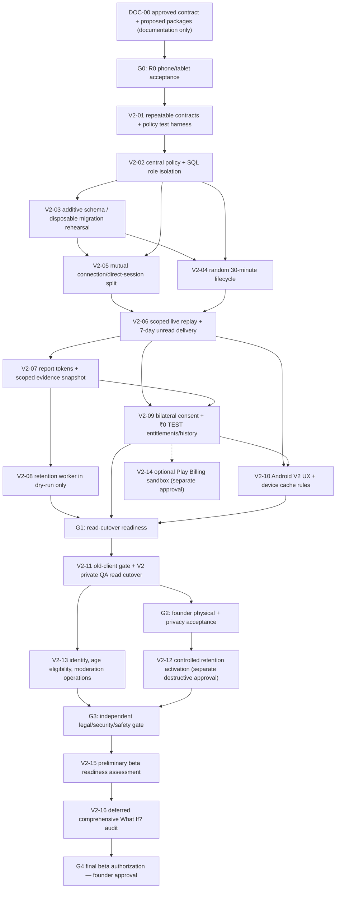

# Bridge V2 — exact implementation packages, dependency graph and release gates

**Status: FOUNDER-APPROVED PR SEQUENCE, DEPENDENCIES, ACCEPTANCE AND ROLLBACK GATES — IMPLEMENTATION NOT AUTHORIZED**  
**Prepared:** 2026-11-15  
**Source baseline:** `main@3578565aa5542a52fdc2679829db6f938cc960d3`, current Render Free QA + Neon Free QA  
**Governing approvals:** [BR-001–029 + D-01–D-07/H-01/M-01](../product/PRODUCT_INVARIANTS_V1.md); [Architecture V2](ARCHITECTURE_V2.md).  
**This PR changes documentation only.** Future PR identifiers below are planning IDs, NOT actual GitHub pull request numbers or implemented work.

## Executive decisions

- Do not redesign or rewrite the stable Flutter/Node/PostgreSQL foundation. Build a **central authorization and policy core** in the existing modular monolith, with truly separate random session, mutual relationship, direct segment, delivery, history and evidence stores.
- **P0 risk**: The current server mutates the source random room into `kind=connection`. This must stop before V2 free-history access policy is activated, or old random messages could be exposed as a paid/free direct history.
- **P0 risk**: Legacy `/v1/.../messages` is a broad read path. Before enabling V2 policy, it must no longer bypass the new restrictions. No rollback may restore this old access.
- **P0 risk**: No report snapshot/evidence storage exists; do not turn on 24h purging until case preservation has been independently validated.
- **P0 migration rule**: Existing 2 synthetic test accounts, 1 active random session, 4 messages and 2 active slots are preserved. Record before/after counts; mark `legacy_qa` only in a separately approved migration; no auto-expire/cleanup.

## 0. Status reconciliation: what's actually done

| Layer | Verified evidence | Status and missing quality |
|---|---|---|
| Product prototype | `prototype/bridge-v1.html`, 18-screen concept | IMPLEMENTED as HTML prototype; not production UX |
| Matching core | `packages/matching`, `apps/api/src/postgres.mjs` | IMPLEMENTED/CI tested; no V2 30m active expiry |
| Durable chat + outbox | `apps/api/src/postgres.mjs`, `outbox.mjs`, `live.mjs` | IMPLEMENTED/CI tested; no scoped V2 free-history |
| Mutual Keep | `castVote()` updates source random conversation `kind` in-place | IMPLEMENTED under old semantics, **conflicts with V2** |
| R0 navigation recovery | PR #14 merged at `3578565a`, Render deployed, cloud QA APK compiled | CI TESTED, backend LIVE in synthetic QA; physical R0 acceptance OPEN |
| Accounts/privacy | Lab-only signed JWT; two seeded testers | No public identity, adult assurance, full privacy flows, refresh |
| Database | 20 RLS-enabled tables, privileged Neon inspection role | SQL owner can BYPASSRLS; **actual Render connection principal unverified**; no scoped delivery/evidence/retention tables |
| Billing | No billing provider or production products | Correctly NOT STARTED; ₹0 TEST grants only later |
| Public moderation/launch | Report intake/blocking exist, no staffed moderation | BLOCKED before any real-user beta |

Old `docs/engineering/ARCHITECTURE_V1.md` proposed NestJS/Supabase and older `docs/DECISIONS.md` says Android-first proposed, while deployed source is Node.js + Neon + Render. These are historical snapshots: **V2 and this plan supersede their current recommendations, not their historical record**.

## 1. Dependency graph (no implementation authorized)

**Parallel work:** Documentation/design/protocol test fixtures can proceed in parallel with R0 device QA after scope authorization, but *no* code execution is authorized by today's approval. Identity/moderation procurement and external providers remain separate commercial/safety decisions. Do not turn on V2 privacy enforcement until G1 proves both new client compatibility and old endpoint safe denial.

## 2. PR-level work packages

The **package sequence and PR boundaries are approved for planning**, but every package remains **NOT APPROVED FOR IMPLEMENTATION**. Each future engineering package needs explicit founder authorization for its code scope, branch/PR, acceptance evidence, migration/deploy checklist and applicable release gate. PR numbers are assigned by GitHub only when created.

### DOC-00 — Contract and roadmap reconciliation (founder-authorized documentation PR #15)
**Paths:** `docs/product/PRODUCT_INVARIANTS_V1.md`, `docs/engineering/ARCHITECTURE_V2.md`, this implementation package file, `docs/ROADMAP.md`, `docs/DECISIONS.md` and an historical supersession notice.  
**Depends:** Founder approvals already supplied; latest repository reconciliation.  
**Acceptance:** BR-001–BR-029, D-01–D-07, H-01/M-01 recorded, no new user-facing functionality asserted; historical evidence remains; old status tracked as such. **No source/database/deploy writes.**  
**Rollback:** Revert documentation-only PR (never touches app or data). **Founder must approve proposed work packages before any application PR.**

### G0 — Existing R0/M2 device verification (not new code)
**Surface:** Current stable synthetic QA APK + Render deployment at `3578565a`.  
**Tests:** phone/tablet login, existing four-message conversation, Back/Resume, two-way new messages, re-login and cancel-search race, mutual Keep, offline SSE replay, expired JWT, report, block LAST (blocking both synthetic accounts can prevent further matching).  
**Exit:** physical PASS/FAIL with build/deploy SHA and redacted device logs, and documented regression/open issue.  
**Restriction:** Do not trigger block/reset/end for the seeded pair without an explicit user test procedure; preserve current data until its fate is agreed.  
**Rollback:** No code; stop QA and record blockers. **Do not mark R0 device accepted without founder evidence.**

### V2-01 — Deterministic contract tests and migration inventory

**Detailed first-stage approval brief:** [V2-01 implementation brief](V2_01_IMPLEMENTATION_BRIEF.md) — exact test paths, live-data exclusion, CI design, deterministic test vectors and rollback. Written for review only; no source-code implementation authorized.
**Paths:** `apps/api/tests/v2/*`, test helper fake DB clock, `tests/*` as needed; test-only fixtures, API contract snapshots.  
**Scope:** BR-ID to test-ID matrix; fake-clock threshold tests at 29:59, 30:00, 7 days, 15min, 24h, 90d/180d; fake payer, unconsenting peer, outsider, blocked/restricted member, two-device races; baseline row/schema/export inventory script in **read-only mode**.  
**Acceptance:** CI runs Node/PostgreSQL tests against disposable database; no runtime behavior differences; source/fixture integrity clear.  
**Rollback:** Revert tests/helpers. **Gate:** test designs approved.

### V2-02 — Server policy core, security-role verification and API deny contracts
**Exact founder-approval brief:** [V2-02 Implementation Brief](V2_02_IMPLEMENTATION_BRIEF.md) — proposes disconnected pure policy kernel, 18 P-series security checks, trusted context model, SQL runtime role audit *design only*, allowed code paths, explicit no-live-wiring boundary and safe rollback. **DOCUMENTED / AWAITING SEPARATE CODE APPROVAL**. No existing API, schema, grants or deployment is altered by documenting it.
**Paths:** `apps/api/src/policy/*` (new), narrow wrappers in `http.mjs`/`postgres.mjs` only if approved, policy unit/integration tests; separate reviewed DB role/grant specification.  
**Scope:** pure policy results `allow/deny` with policy-version/decision code and no private payload; distinguish LIVE/UNREAD/HISTORY/REPORT/EVIDENCE; account/peer safety and block checks; audit Render runtime connection role **without publishing credentials**; determine least-privilege app role and migrator separation.  
**Acceptance:** Complete access matrix denies stale/guessed/third-party IDs and spoofed client `premium` fields; no unintended privileges; older QA functionality remains behind declared compatibility policy.  
**Rollback:** Disable new inactive policy path, retain logs/tests; do not change live DB grants until separate authorized gate. **Gate:** security review before applying any runtime grant change.

### V2-03 — Additive schema and migration rehearsal
**Detailed implementation brief:** [V2-03 Additive Schema and Disposable Migration Brief](V2_03_IMPLEMENTATION_BRIEF.md) (DOCUMENTED; separate founder authorization required for any SQL/test code). Proposed four migration layers 0004–0007, 14 new scoped tables, nullable V2 metadata, synthetic legacy preservation, migration checksum ledger, test-only PostgreSQL CI and explicit no-live-Neon gate. The existing `bridge_messages.body NOT NULL` relaxation is **outside this strictly additive stage**; defer to separately approved V2-06/V2-11 cutover.
**Paths:** `database/migrations/0004_*` and later numbered additive migration(s), DB integration tests and migration documentation.  
**Scope:** add nullable policy/expiry/immutable-kind fields; relationship/direct-session uniqueness; message payload/metadata separation, unread envelopes, history consent/items/test grants, report-token/evidence, retention jobs, policy ledger; design `legacy_qa` protection. Use constraints/indexes gradually.  
**Acceptance:** Disposable DB apply/reapply/backout rehearsal, FK/unique tests, production-shaped synthetic dataset, old API compatible during expand; zero missing rows; DB role privilege matrix verified.  
**Rollback:** On test DB, restore disposable snapshot. When later authorized in live QA, **leave additive tables untouched and disable new feature routes**; no destructive down-migration. **Gate:** founder separately authorizes any live Neon DDL.

### V2-04 — Random session 30-minute expiry and slot-safe cleanup
**Exact code-approval brief:** [V2-04 Random Lifecycle & Expiry Implementation Brief](V2_04_IMPLEMENTATION_BRIEF.md). This is **DOCUMENTATION ONLY / AWAITING SEPARATE ENGINEERING APPROVAL**. The first proposed PR (**V2-04A**) builds a disconnected session adapter plus disposable PostgreSQL race tests, without importing it into live `postgres.mjs` or `http.mjs`; expiry activation remains a distinct permission after Neon migration and R0/legacy safety gates. Includes 24 numbered R04 test cases and a fresh-DB-clock-after-lock contract.
**Paths:** `apps/api/src/sessions/*`, matching/service integration tests, bounded inactive-sweeper code (disabled by default for QA legacy).  
**Scope:** add DB-clock `idle_expires_at`, accepted-unique-message timer reset, no extension from Keep, read, typing or idempotent retry, expiry transaction vs matching/Keep/block, terminal `expired/ended/converted/safety_closed`; release slots exactly once; preserve legacy.  
**Acceptance:** t=29:59 allowed, t=30:00 denied even if worker down; two-device/cross-transaction races no duplicate slots and no resurrection; legacy fixture untouched.  
**Rollback:** New policy OFF for synthetic canary prior cutover; safe-deny new rooms if clock state uncertain; **never** roll back to unrestricted expiry after privacy cutover. **Gate:** founder approves activation scope.

### V2-05 — Immutable stranger source and free mutual direct-session creation
**Exact implementation brief:** [V2-05 Immutable Random Source, Mutual Keep & Free Direct Sessions](V2_05_IMPLEMENTATION_BRIEF.md). **DOCUMENTED / AWAITING SEPARATE CODE APPROVAL**. Recommends **V2-05A** disconnected transaction engine and PostgreSQL 16 synthetic tests (C05-01–C05-30), with **V2-05B hosted activation** independently gated on the live additive migration and safe old-message API cutover. No original random transcript conversion or copying, no payment for free mutual recontact, no R0 hardware PASS inferred.
**Paths:** `apps/api/src/connections/*`, `sessions/*`, service and PostgreSQL tests.  
**Scope:** replace in-place `kind=random -> connection` conversion for **new V2 rooms only**; atomically create connection and close source as `converted`; create NEW empty direct session with fresh sequence; strict dual Keep and withdrawal/block; one concurrent direct session per connection, 30m direct idle; relationship itself persists.  
**Acceptance:** old random text absent from new direct transcript; one-sided Keep cannot message later; 2 accepts create one relationship; direct free reopens next day as *new* session; block/unmatch revokes access.  
**Rollback:** Switch only unmigrated canary traffic back to old isolated QA behavior **before** history policy activation; for migrated relationships use forward fix, never transform direct rows back into random or revive source transcripts. **Gate:** backend concurrency review.

### V2-06 — Scoped live replay and finite 7-day unread delivery
**Paths:** `apps/api/src/messaging/*`, scoped REST/SSE handlers, message cursor adapter and tests.  
**Scope:** LIVE scope is current session only; UNREAD scope is per-recipient unconsumed envelope up to 7d; first acknowledgment issues 15m idempotent recovery; opaque cursor/checkpoints/tombstones preserve sequence progression after body purge; no generic previous-session pagination. No message content in SSE hints/logs.  
**Acceptance:** 2-device offline ordering and duplicate retries exactly-once visible; t=7d expiry denied; 15m recovery bounded; guessed room/recipient IDs denied; stale v1 API cross-check; original four QA messages never migrated implicitly.  
**Rollback:** New scoped API disabled and compatible synthetic legacy path only before G1; afterward fail closed without restoring unauthorized history. **Gate:** backend + mobile protocol contract frozen.

**V2-06 planning update (2026-11-16; NO implementation authorization):** [exact V2-06 implementation brief](V2_06_IMPLEMENTATION_BRIEF.md) recommends V2-06A as an **isolated/disconnected** current-session scope, ordering/checkpoint and recipient-scoped unread policy/repository under new apps/api/src/messaging/**, with synthetic opaque-byte fixtures and disposable PostgreSQL 16 race tests. It does **not** approve actual encrypted content handling, modify current HTTP/PostgreSQL/SSE, connect to Neon, apply SQL migrations, issue recovery tokens to hosted users, change Android or run retention. A storage/key-management decision is prerequisite because 0005 bytea is not encryption and legacy bridge_messages.body remains NOT NULL. Later V2-06B integration and G1/V2-11 old-route safe-deny need **separate founder approval**. The proposed 7-day/recovery crossing rule is explicitly subject to founder review. The full 30-case candidate acceptance matrix, risks and rollback are in the brief.

**V2-06B documentation proposal — 2026-11-16, NOT approved for implementation:** [Private Messaging Storage & Safe Integration Brief](V2_06B_INTEGRATION_SECURITY_BRIEF.md) and [Threat Model](V2_06B_THREAT_MODEL.md) follow V2-06A's isolated merge/green CI. To eliminate the existing V1 body NOT NULL / 0005 FK coupling and privacy read-bypass risk, **recommend**, pending founder decision, an independent V2-only metadata / AEAD ciphertext / recipient unread store under a **new** additive migration (candidate 0008; never edit 0001–0007). Stage B1 would be disconnected PostgreSQL-16 migration and crypto-key contract tests only; B2 separately approved trusted policy, storage adapter and atomic-message integration tests; actual HTTP/Neon/Render/Android **activation waits for V2-10, G1/V2-11 and explicit founder sign-off**. No live database inspection, paid KMS, real message plaintext, hosted encryption key, deletion or source-code changes are authorized by this documentation. The 32 proposed B06 security acceptance cases are **not implemented or tested**. R0 physical acceptance OPEN; old test history preserved; What If? final V2-16 unchanged.

**V2-06B/B1 exact implementation specification — 2026-11-16 (DOCUMENTATION ONLY):** The [B1 implementation brief](V2_06B_B1_IMPLEMENTATION_BRIEF.md) and [B1 Schema/Crypto Contract](V2_06B_B1_SCHEMA_CRYPTO_CONTRACT.md) define separate **B1a** and **B1b** founder approval gates. B1a proposes **new 0008** tables for versioned secure message metadata/LIVE ciphertext/recipient-only UNREAD, a **separate test-only 0008 migration runner** and disposable PG16/RLS/rollback/restore evidence. Do **not** modify the historic V2-03 four-ledger/34-table test runner: run new isolated 0008 after prior checks, creating 37 tables on disposable bridge_test. B1b proposes standalone authenticated AES-256-GCM DEK/KEK/AAD codec with synthetic keys and no real data. Both remain NOT APPROVED FOR SOURCE IMPLEMENTATION, do not touch old V1 message body or hosted API/Neon/Render/Android, and require distinct PR-head+post-merge CI with exact file allowlists. B2 future trusted adapter and G1/V2-11 activation remain independently gated. R0 physical acceptance OPEN, V2-16 138-case What If? final unchanged.

**B1a completion evidence — 2026-11-16:** Additive source-only `0008` secure messaging schema + test-only disposable runner **MERGED** via [PR #30](https://github.com/rayadinaveen98-ship-it/bridge/pull/30) main@a27467887e6cfd855b2ba980da5b0d2d5a9565b1. Exact PR-head, push and postmerge Foundation matching + PG16 integration checks passed; [evidence register](V2_06B_B1_EVIDENCE.md). Old 0004–0007 runner's 34 tables/four ledger remain unchanged and ran first; new isolated 0008 tests prove 37 disposable tables/five receipts. Earlier flake in independent V2-06A test fixed in separate one-file [PR #31](https://github.com/rayadinaveen98-ship-it/bridge/pull/31); no B1a allowlist extension. **B1b AEAD/key-contract source NOT AUTHORIZED/NOT STARTED**; no actual message encryption, live Neon migration, Render/Android integration, retention, billing or public user rollout. R0 physical gate open; V2-16 final What If? unchanged.

**B1b completion certificate — 2026-11-16:** [PR #33](https://github.com/rayadinaveen98-ship-it/bridge/pull/33) implemented the previously approved seven-path standalone **synthetic-only** AES-256-GCM/key-contract code, merged main@c4f970f3ceabcf2758e76e10c74f4be7a75543c5. Exact [PR CI #43840591295](https://github.com/rayadinaveen98-ship-it/bridge/actions/runs/43840591295) and [post-merge #43840915608](https://github.com/rayadinaveen98-ship-it/bridge/actions/runs/43840915608) both matching+PostgreSQL SUCCESS; **21/21 pure tests** passed. [B1b evidence](V2_06B_B1B_EVIDENCE.md) describes cryptographic test coverage and limitations. No real keys or production KMS, no live or Android message content, no SQL 0008 application to Neon, no Render deploy, billing, moderation, retention deletion, changes to original four synthetic QA messages, or public beta. **B2 trusted adapter requires separate founder-reviewed design and scope approval**, and any hosted cutover still requires V2-10 + G1/V2-11 old endpoint safe-deny, runtime roles and R0 hardware evidence. V2-16 final 138-case What If? unchanged.

**B2 exact disconnected adapter implementation proposal — 2026-11-16, DOCUMENTATION ONLY:** [B2 implementation brief](V2_06B_B2_IMPLEMENTATION_BRIEF.md), [threat/acceptance matrix](V2_06B_B2_THREAT_AND_ACCEPTANCE.md), and [key/DB privilege decisions](V2_06B_B2_KEYS_AND_PRIVILEGES.md) were prepared against verified main@7ca0865b. **B2a code NOT APPROVED:** proposed 7-file new disconnected V2-only encrypted-acceptance repository with synthetic loopback PG16, atomic room/recipient ciphertext+body-free outbox, dedup, server clock, Block/Keep/expiry race tests; old V1 and current B1 schemas untouched. **B2b code separately gated:** proposed 6-file recipient-unread/current-live authorized delivery/ack/recovery test adapter. No hosted V2 HTTP, Android, Neon schema/roles, Render deploy, new keys/KMS, billing or retention. Existing 0006 history and 0007 case evidence foreign keys still point to legacy `bridge_messages`; separate V2 secure-message-ID linkage decision needed for V2-07/09, never fake legacy plaintext. Real role/RLS, durable keys, adult eligibility and old-client safe-deny are future founder-gated decisions. R0 physical phone/tablet OPEN; final V2-16 138-case What If? remains last.

**B2a completion certificate — 2026-11-16:** [PR #36](https://github.com/rayadinaveen98-ship-it/bridge/pull/36) implemented seven exact allowlisted disconnected encrypted V2-only acceptance, synthetic PostgreSQL fixtures/races and CI test files; merged main@e2cae7af30d51cb5111c8f31d4566d8b3af935d5. [Final PR CI #43849838361](https://github.com/rayadinaveen98-ship-it/bridge/actions/runs/43849838361), push #43849829195 and [postmerge CI #43850018131](https://github.com/rayadinaveen98-ship-it/bridge/actions/runs/43850018131) each matching and postgres-integration SUCCESS. **14/14 acceptance + 12/12 race TAP** results passed (parent wrappers included); [evidence](V2_06B_B2_EVIDENCE.md). Original four synthetic QA messages unchanged. No legacy V1 route/source edit, SQL migration 0001–0008 edit/application to Neon, hosted Render/Android, actual runtime key or real user message. **B2b read/ack/recovery separately gated** (6 paths); no fully serialized live V1 Block-vs-B2a read race proof, runtime RLS/roles, key custody or safe old-client cutover. R0 phone/tablet acceptance OPEN; V2-16 138-case What If? FINAL.

**B3 authenticated API/Android compatibility and security release PLAN — 2026-11-16 (DOCUMENTATION ONLY):** Verified `main@f8b18c4cae7736179b0ce8487168d4cb3fb81a6e`, [Foundation #43854756002](https://github.com/rayadinaveen98-ship-it/bridge/actions/runs/43854756002) both CI jobs SUCCESS. B1a/B1b/B2a/B2b are code-merged, isolated in synthetic PostgreSQL/pure Node tests, **NOT ACTIVE** in hosted HTTP/Neon/Render/Flutter. B3 design: [exact integration and proposed B3a package](V2_06B_B3_INTEGRATION_BRIEF.md), [complete V1 read/write endpoint and Android compatibility matrix](V2_06B_B3_ROUTE_CLIENT_MATRIX.md), [key/provider/role/physical release gates](V2_06B_B3_SECURITY_RELEASE_GATES.md).

**B3a next founder gate — code NOT APPROVED:** proposed seven paths, two new `apps/api/src/v2/` pure policy/response modules; two new pure route/response contract tests; additive `apps/api/package.json` script and matching CI step; B3 evidence document. No modifications to `http.mjs`, `postgres.mjs`, `start.mjs`, SQL, Android, app roles, real keys or deploy. Pure contracts cannot certify real old-client safe-denial. **B3b separate approval:** disconnected synthetic RS256 subject -> account -> B2 trusted facade and disposable PG16 auth/race tests. **B3c separate approval:** read-only redacted actual Render database principal/RLS role inspection, durable key custody/provider/budget/rotation and security review, no hosted action without explicit scope. **B3d/G1/V2-11:** only after old V1 GET **and POST** /messages, SSE, bootstrap, peer, Keep, connections and any alternate V1 path are proven to safe-deny V2 IDs on actual network before first V2 ID is exposed; rollback never reopens old plaintext replay.

**Precise race finding:** existing V1 `block()` already uses mutex 714411, unlike `unblock()`; a full V1+V2 account status/revocation and endpoint race certificate is still absent. Legacy report/history FK references to `bridge_messages` need future V2-07/V2-09 additive redesign. Current Flutter API only supports V1 routes; V2-10 Android and R0 physical phone/tablet acceptance OPEN. B2b five-minute presentation proof is test-only; 15m recovery/original 7d cap are user-approved. 0008 not applied to Neon; real RLS principal and production keys unverified. Final 138-case What If? remains V2-16 LAST. No source, hosted QA, billing, retention or subscription authorized by this planning PR.

**B3a certification and B3b-1 signed-subject implementation SPECIFICATION — 2026-11-16 (B3b code NOT APPROVED):** Verified `main@ba24e82fa8c4477dc3fab757a0df2f607191d50a`, Foundation [#43866135238](https://github.com/rayadinaveen98-ship-it/bridge/actions/runs/43866135238) matching and PG16 SUCCESS. B3a [PR #41](https://github.com/rayadinaveen98-ship-it/bridge/pull/41) implemented pure route/response compatibility, **25/25 TAP PASS**, [PR #42](https://github.com/rayadinaveen98-ship-it/bridge/pull/42) documented; NOT LIVE. [Exact B3b-1 8-file scope](V2_06B_B3B_IMPLEMENTATION_BRIEF.md), [identity and race acceptance](V2_06B_B3B_TRUST_RACE_MATRIX.md) now PROPOSED. B3b-1 should be ONLY disconnected synthetic signed RS256 subject -> `bridge_accounts.auth_subject` with in-transaction `FOR UPDATE` identity eligibility and callback; one new source file, four new test/fixture files, additive named package runner + matching/PG16 CI steps, and a new evidence file. Recheck JWT expiry after advisory lock; preserve all legacy QA and hosted runtime. **B3b-2** is a separate founder-gated redesign to bind verified identity and B2a/B2b message/UNREAD operations in the **same** transaction (B2 engines currently open their own). Preflight lookup plus separate B2 call is NOT atomic authorization; do not falsely certify it. No old V1 route edits/secret/provider/Android/Neon/Render/retention/billing or real encryption activation in B3b-1. Actual Render RLS/key custody/age assurance remain unresolved, R0 Android acceptance OPEN; full 138-case What If? V2-16 FINAL.

### V2-07 — Report tokens and case evidence isolation
**Paths:** `apps/api/src/safety/*`, restricted case evidence data access, tests; reviewer role/RBAC defined but no real-staff claim.  
**Scope:** hashed 7d reporter-bound opaque post-end token; report action validates participation; capture minimum needed messages/metadata **transactionally** while content exists; encrypted scoped case snapshot, reviewer-only logged access; late reports can include user details but cannot invent purged evidence.  
**Acceptance:** reporter at 23h59 creates usable case evidence; after ordinary purge only lawful metadata/user details; no premium access; outsider reporter denied; evidence permissions and audit tested; no public moderation claim.  
**Rollback:** Keep evidence-preservation route safe; stop new purge activation if evidence path fails; never delete pending incident case during rollback. **Gate:** safety and privacy review.

### V2-08 — Retention engine, DRY-RUN ONLY
**Paths:** `apps/api/src/retention/*`, manifest and worker tests; no scheduler enabled against live QA.  
**Scope:** independently classify LIVE, UNREAD, HISTORY, CASE and operational log records; compute 24h/7d/90d/180d deadlines, legal holds, backup deletion replay; lease/retry/idempotent batches; dry-run would-delete manifest and lag metrics. **No actual deletion.**  
**Acceptance:** fake clock proves correct selection and exclusions; snapshot preservation before purge; test worker crash and repeat; audit has no message bodies; zero false-positive deletion targets.  
**Rollback:** Disable worker and reject unsafe retention action. **Gate:** separate founder approval required before any live delete.

### V2-09 — ₹0 TEST entitlements, bilateral consent and prospective history
**Paths:** `apps/api/src/entitlements/*`, `history/*`, protected grant tooling (QA only), consent API and tests.  
**Scope:** audited server grants with `environment=qa`, expiry and revocation; both consent versions effective at NEW message acceptance; optional separate encrypted history item; 90-day max; one-sided consent / fake premium can't retain/read; withdrawal immediately denies and queues 24h ordinary-copy deletion as separately gated. **No billing integration**, provider keys, paid UI, charging or promotion.  
**Acceptance:** full 2x2 consent x entitlement matrix; no past/random message copy; 90d expiry denies even when cleanup late; refund/revoke simulation denies; permissions logged.  
**Rollback:** Revoke TEST grants and deny history endpoints; any retained private items remain inaccessible pending reviewed purge, not recoverable through old API. **Gate:** founder approval for TEST grant setup and eligible test fixtures.

### V2-10 — Android V2 UX and local data discipline
**Paths:** `apps/mobile/lib/*`, widget/golden/a11y test files and controlled Android QA build workflow only if in scope.  
**Scope:** explicit random countdown, Keep vs End, connected peers vs active direct session, free unread inbox with ack/recovery, no previous timeline, retention consent and test entitlement messaging, graceful expiry/relogin/offline/error, no body in automatic backups/notification previews; approved design tokens across phone/tablet.  
**Acceptance:** widget tests and screenshots for 18 core destinations plus empty/loading/error/denied; large text, TalkBack, keyboard, RTL; install/update state; two-device PASS; never label fake QA eligibility as true verified adult.  
**Rollback:** Revert client only while compatible safe server continues to deny forbidden content; force minimum safe version if old client could bypass policy. **Gate:** founder visual and physical acceptance, no new design direction without approval.

### G1 + V2-11 — Privacy-safe API cutover, old-client gate, synthetic QA rollout
**Paths:** `apps/api/src/http.mjs` scoped v2 dispatch and old-v1 deny behavior, version configuration, Android compatibility tests, deployment runbook.  
**Scope:** on synthetic QA only, version-based client behavior, v1 generic history replay permanently safe-denied or made V2-scoped, V2 live/unread/history enabled with DB policy authorizer; staged server-before-app and app-update strategy; no stale install has unrestricted read.  
**Acceptance:** *zero* unauthorized old/v2/guessed-ID reads; no hidden history through Android caches/notification/backup; full active sessions/Keep/unreads work; all CI plus physical pass on known SHA; no data loss; Render deploy approved per gate.  
**Rollback:** **PRIVACY CUTOVER IS ONE-WAY**: revert to explicit safe-deny/maintenance read mode and forward-fix; never restore broad v1 history. Disable new features selectively without opening private data. **Gate:** separate founder approval of exact migration + deployment + version cutover.

### V2-12 — Controlled retention activation (requires distinct deletion approval)
**Paths:** Retention worker enablement, reviewed SQL/manifest, operational schedule and alerts.  
**Scope:** run **only** on verified V2 rows after a reviewed dry-run; legacy QA room stays exempt. Hard-stop if evidence missing or unexpected counts. Track irreversible physical deletion and backup tombstone replay.  
**Acceptance:** signed deletion manifest, 100% case-exception preservation, no premature/duplicate loss, deterministic idempotence, minimum retained content, dashboard alerts; founder receives after-action data evidence.  
**Rollback:** Stop worker/schedule; safe-deny remaining content; **physically deleted messages cannot be rolled back**. Restore backup only with deletion-ledger replay and explicit disaster recovery authorization. **Gate:** explicit destructive action approval for each initial canary.

### V2-13 — Production identity, age/safety and operations (separate public-use gate)
**Paths:** Production auth/session refresh/revocation, adult-eligibility integration, report reviewer RBAC, privacy workflows, abuse rate limiting, support, monitoring, incident runbooks. **External providers/contracts require approval.**  
**Scope:** accountable-to-platform pseudonyms; distinct operational identities, secure key rotation, reviewer least privilege and escalation coverage, legal/Google Play assessment, cross-region log obligations, per-account/device/network abuse controls, privacy export/delete.  
**Acceptance:** independent auth/age/safety/pen-test review, practical staffed moderation response and appeals, rate/load/cold-start behavior, privacy rights exercise, legal signoff; real minors and real strangers blocked until gate.  
**Rollback:** Disable public signup/discovery, keep report/privacy access safe; do not relax adult/safety policy. **Gate:** separate compliance, staffing, cost and founder approval.

### V2-14 — OPTIONAL Google Play Billing sandbox
**Dependencies:** V2-09 TEST entitlement policy, approved SKU/pricing, provider/policy/legal review; can occur after core reliability.  
**Scope:** sandbox receipt verification, test renewals/refunds/revocations, server-side grants; no real charge; no paid product creation without approval.  
**Acceptance:** forged receipts denied, refunds revoke history, subscription expiration readable state; safety/consent independent.  
**Rollback:** Billing flag off; no premium authorization based solely on client; existing approved entitlements handled safely. **Gate:** separate commercial + platform policy approval.

### V2-15 — Preliminary invite-only adult beta readiness assessment (not release authorization)
**Dependencies:** V2-11 private QA pass, retention and safety operational gates, adult eligibility, sustainable capacity and costs, legal/policy review.  
**Acceptance:** founder-approved beta population and region/language safety coverage; explicit dashboard of matching, successful sessions, retention, mutual Keep, report response, abuse, privacy requests, operational spend; stop/go thresholds set *before* beta.  
**Rollback:** Pause registrations/discovery, preserve appropriate safety/rights handling; incident communication runbook. **Gate:** explicit public-facing release authorization.

### V2-16 — Deferred end-of-roadmap comprehensive What If? audit and certification

**Placement decision: DEFERRED TO END per founder, 2026-11-15.** The [138-case What If? Scenario Atlas](../product/WHAT_IF_SCENARIO_ATLAS_V1.md) and [QA strategy](WHAT_IF_QA_STRATEGY_V1.md) remain reference drafts. Full experience mapping, 13 proposed UX defaults and formal 138-case completion review are **not prerequisites** to beginning V2-01 and do not interrupt V2-01 through V2-15. All new UX defaults remain proposed until approved.

**Mandatory exception:** Already-approved core V1/V2 rules and security-critical negative tests (e.g. no unauthorized history, no message after expiry/block, mutual Keep integrity, no evidence leaks, no old endpoint bypass) must be implemented/tested in their **normal earlier packages**. Deferring the comprehensive audit does not authorize ignoring privacy or safety bugs.

**Scope:** Once core architecture and Android work have been completed and the preliminary adult-beta readiness has been assessed, exhaustively reconcile all 138 `WF-` cases across happy paths, non-happy paths, OS kill/reopen, network failure, session renewal, reporting, accessibility, consent/history, payments sandbox if enabled, safe rollback and retention, without changing production behavior during review.

**Exit:** Full scenario traceability and physical phone/tablet evidence; P0=PASS or release blocked; all proposed policies specifically approved or deferred with documented impact; signed security/privacy/UX and founder review. **No real-user beta may launch before this final gate.**

**Rollback:** Documentation/review-only until separately approved fixes; issues are assigned to small implementation PRs with their own acceptance. This is not authorization to ship code, delete data or purchase services.

## 3. Exact hard gates and evidence

| Gate | Prerequisites | Must show | If failed |
|---|---|---|---|
| G0 R0 acceptance | Existing R0 APK and two synthetic devices | Device model, build SHA, step log, message preservation and failures | R0 remains OPEN; do not claim completed |
| G1 V2 read cutover | V2-01–10 test suites and migration rehearsal; all affected old endpoints mapped | Zero unauthorized history reads across old/v2 APIs, body-free SSE, bounded replay, two-device preview | NO CUTOVER; old QA maintained, no public accounts |
| G2 V2 physical/privacy | G1, approved synthetic QA deploy and matched APK | End-to-end free / mutual / unread / consent / block / report / expiry, no data loss, redacted evidence | Shut V2 read to **safe-deny**, forward fix; do not revert to leaked history |
| G3 retention activation | V2-07+08 evidence correctness, dry-run manifest and legal review | Exact target set, cases/holds excluded, backup deletion ledger, founder written approval | Deletion scheduler disabled; nothing purged |
| G4 public safety | V2-13, legal/policy and on-call moderation coverage | Age assurance, staff response, verified auth, privacy requests, abuse controls, production monitoring | No real-user stranger matching |
| G5 monetization | V2-09, founder SKU/price consent, platform compliance | ₹0 test grant independence, server verification, refunds and consent | Billing off and no purchases |

## 4. Regression / traceability map

| Invariants | Engineering packages | Negative acceptance case |
|---|---|---|
| BR-001/002/003, D-01 | 01, 02, 04 | Ineligible/unmatched/duplicate attempt denied; no language bias |
| BR-004/005/006, D-01, D-06a | 04, 05, 10 | At exactly 30m random/direct chat denied; Back does not reset clock; expiry can't reopen |
| BR-007–011, D-03 | 02, 05, 10 | One Keep cannot DM; second Keep creates clean new session; source cannot import |
| BR-012–014, D-02, D-06b | 02, 06, 10, 11 | Free history paging via v1/v2/backup/old APK fails; unread 7d and recovery <=15m |
| BR-015–018, D-04, H-01 | 02, 09, 10 | Paid grant with no bilateral consent cannot retain/read; 90d and revoke enforced |
| BR-019–023, D-05, D-07a/b | 07, 08, 10, 12, 13 | Case evidence never copied to paid viewer; 7d report token cannot reopen old room |
| BR-024–026, M-01 | 01–03, 11, 12 | Guessed ID denied; roles scoped; two testers and four legacy messages preserved |
| BR-027–029 | 10, 11, 13, 15 | No unverified public/Apple release; device+ops evidence before milestone closure |

## 5. Rollback taxonomy

- **R0 / Docs:** ordinary Git revert (documentation only).
- **R1 / Additive & disabled:** disable feature flag and leave compatible schema; no destructive down migration.
- **R2 / Data has V2 new writes:** block unsafe operations and forward-fix; preserve message IDs and evidence, do not attempt in-place backwards transformation.
- **R3 / Privacy cutover:** SAFE-DENY / minimum-safe-client fallback only. Rollback may **never** reopen old unrestricted `GET /v1/.../messages`.
- **R4 / Physical purge:** fundamentally irreversible. Halt worker, contain impact, audit target set; any backup restore is a separately authorized incident action with deletion-ledger replay.

## 6. Estimated effort and cost boundaries

Planning ranges for one effective engineer, not deadlines or background promises; dependent phases are not simply additive to a calendar schedule:

- V2-01–03 architecture contracts + security/schema rehearsal: roughly **2–4 weeks** including review and CI.
- V2-04–07 lifecycle, relationship, delivery and report evidence: roughly **4–8 weeks**, sensitive concurrency/security reviews.
- V2-08–12 retention/consent/Android/read cutover: roughly **4–8 weeks** plus actual device acceptance and legal review.
- V2-13 operational production identity/moderation/age assurance: roughly **3–6+ weeks** and may be externally constrained; not covered by free QA tools.
- Optional V2-14 Play Billing sandbox: roughly **1–3 weeks** after commercial approval.
- Beta/release: **not scheduled**.

Synthetic internal QA remains on **₹0 planned incremental cost** using existing free tiers subject to limits. No payment provider, moderation vendor, Firebase, Redis, cloud upgrade or subscription may be activated or purchased from this plan.

## 7. Founder approvals separated by scope

1. **Approved for documentation/planning:** DOC-00 and the V2-01 through V2-15 package sequence, dependencies, acceptance and rollback gates. The comprehensive What If? audit remains **V2-16 at the end**; critical per-package safety/privacy tests remain compulsory. No application implementation is automatically authorized.
2. **Engineering stage:** explicitly approve each proposed implementation package (or defined bundle with clear scope), including any code writes.
3. **Database:** independently approve migrations and write tests against dedicated QA only after backup/rehearsal.
4. **Deployment:** approve exact backend SHA/Android build and protected cutover.
5. **Retention:** independently approve live deletion manifest and canary activation.
6. **Commercial:** independently approve any Play Billing, SKU, price, vendor or cost.
7. **Beta:** independently approve real-user access only after adult/safety/legal and ops gates.

## 8. Documentation acceptance ledger / next work

- DOC-00 documentation-only PR #15 has been **approved for final review and merge**; consult GitHub for the current merge status.
- After approval, reconcile stage tracking in `docs/ROADMAP.md` with the packet's IDs and maintain a permanent `docs/DECISIONS.md` status log.
- Before starting V2-01, capture the latest branch SHA, full current API route inventory, stable R0 device result, current table privileges/roles, exact current schema baseline, and first prospective policy test vector fixtures.
- Keep prior V1/R0 records as historical, identify superseded portions rather than deleting them.
- **Stop/go rule:** if authorization, evidence, migration or data integrity cannot be demonstrated, do not expand scope or proceed to the next phase.

**Reference:** Founder-approved Architecture V2 full draft `BRIDGE-ARCH-V2-20261115` (426-line artifact) and normalized approved [V2 contract](ARCHITECTURE_V2.md). The above is a *proposed delivery decomposition*, not a claim that any V2 functionality exists.
