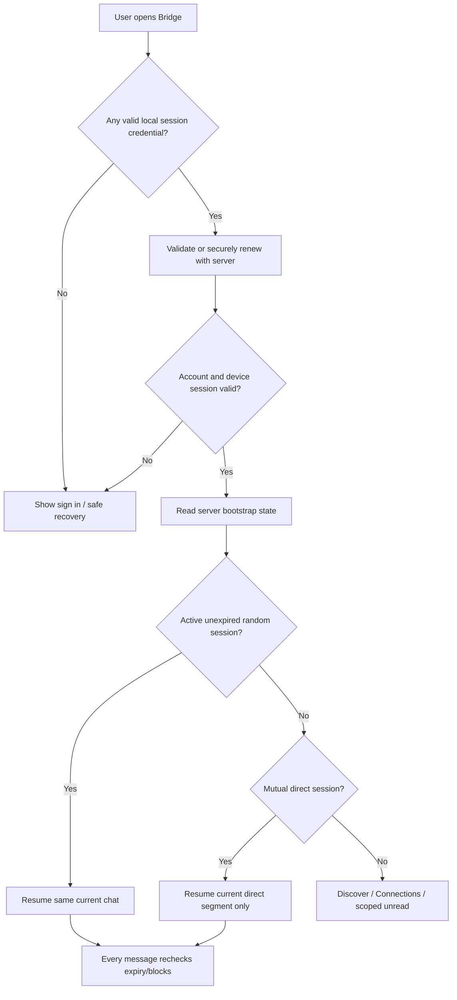

# Bridge — What If? Scenario Atlas V1
**Status:** PROPOSED scenario and experience contract — founder review required for behavior not already in the approved V1/V2 invariants.  
**Prepared:** 2026-11-15. **Scope:** Documentation and research planning ONLY. No app/database/deployment/billing changes.  
**Baseline:** `main@3578565a`; current R0 synthetic QA not physically accepted on phone/tablet.  
**Controlling specifications:** [Product Invariants V1](PRODUCT_INVARIANTS_V1.md), [Architecture V2](../engineering/ARCHITECTURE_V2.md), [V2 PR packages](../engineering/V2_IMPLEMENTATION_PACKAGES.md).  
**Companion test plan:** [Scenario Coverage & QA Strategy V1](../engineering/WHAT_IF_QA_STRATEGY_V1.md).

## Why this is a new gate

A successful **happy-path** chat is not adequate. State restoration, failure containment, privacy, consent, notifications, billing, reporting, accessibility and multi-device races must be specified before implementation PRs. Android can destroy a background process without a user-initiated logout. Remote account status, chat expiry and delivery acknowledgment must therefore be server-authoritative, not inferred from the foreground screen.

**Interpretation of statuses:** `Locked` = outcome follows an existing founder-approved invariant or established R0 behavior, though it may NOT be implemented yet. `Proposed UX` / `Proposed auth UX` / `Review needed` = requires founder ratification before behavior becomes a product rule. `Pre-beta gate` = mandatory operational/safety work but not yet delivered. `Existing baseline` = behavior supported by current source; physical QA may still be pending. `Deferred billing` = no payment activation authorized.

## Critical differentiation — three different end states

1. **Close app / background:** UI/process state changes. Does NOT equal logout and does NOT end chat by itself. Accepted-message inactivity clock keeps running.
2. **Logout:** Authentication authority ends for that device (or all devices if explicitly selected). It does not magically revive or close the random room; that room expires by server policy unless explicitly ended.
3. **End chat:** Session terminal state, permanent for that session. Does NOT delete the account; direct-session End does NOT end a mutual relationship.

And four different clocks: `120s matchmaking queue` (existing QA default); `30m random/direct accepted-message inactivity` (approved V2); `30m synthetic JWT lifetime` (current lab authentication, not the production session policy); `7d unread envelope TTL` (approved V2). **Never conflate these.**

## Proposed production reopen experience (NOT the current lab behavior)

**Current internal QA reality:** `BridgeController` holds `BridgeApi` bearer in memory; `lab_auth.mjs` issues a 30-minute JWT; no durable refresh mechanism or silent production login exists. Today a real process kill generally requires re-entering synthetic lab credentials. Production-friendly restore using short-lived access credentials plus securely held revocable, per-device refresh capability is **recommended**, not approved or implemented.

## Canonical success/failure response pattern (proposed)

Every scenario gets: **trigger -> visible, understandable state -> immediate user options -> truthful server action -> safe cache/notification handling -> analytics without body -> test evidence**.

- Network failures: mark unknown/unconfirmed, avoid announcing success until server acknowledges, retry idempotently.
- Authorization failures: deny without leaking another account/room, hide stale sensitive content, show available sign-in/appeal/report path.
- Expired room: explain it ended; allow a new search, not old history recovery.
- Safety: permit report without requiring payment or re-opening conversation; acknowledge only after backend report receipt.
- Consent/entitlement: require BOTH ongoing consents for retained history, and entitlement only for the viewer; never restore old random text.
- Upgrade: old app clients are not a back door to disallowed history.

## Scenario atlas

Each expected behavior must turn into a UX flow, backend rule/test assertion, and where relevant Android device evidence. P0 = security/data/consent/core session blocker; P1 = reliability/accessibility/day-to-day; P2 = lower-priority convenience. This is **not** an implementation report.

### A. First launch, onboarding and eligibility

| ID | What if? | What the user should experience | Server/product contract | Priority | Decision status |
|---|---|---|---|---|---|
| WF-A01 | Fresh install first launch | Welcome -> adult eligibility -> terms -> pseudonym -> explicit languages -> Discover | Backend rejects discovery until all gates pass | P0 | Locked |
| WF-A02 | User declines Terms of Use | Show what is unavailable and allow exit/privacy help | No discovery or message write without current consent | P0 | Locked |
| WF-A03 | Age verification cannot complete | Explain retry or independent appeal; no fake age bypass | Remain ineligible, no matching | P0 | Locked |
| WF-A04 | User appears underage | Give neutral denial and safety information | Restrict account; no anonymous/random chat | P0 | Locked |
| WF-A05 | No supported language chosen | Show language selector, not a default | Matching requires explicit shared moderation-ready language | P0 | Locked |
| WF-A06 | Preferred language lacks moderation coverage | Honest unavailable-language state and other supported choices | No hidden English fallback or unequal ranking | P0 | Locked |
| WF-A07 | User skips optional topics/interests | Allow compatible general discovery | Do not force optional personal profiling | P1 | Proposed UX |
| WF-A08 | Onboarding interrupted by app kill | Resume at incomplete step without leaking content | Persist only nonsensitive completion metadata | P1 | Proposed UX |
| WF-A09 | Permission denied during onboarding | Continue text-only without unnecessary device permissions | Require only technically necessary permissions | P1 | Proposed UX |
| WF-A10 | User changes pseudonym mid-chat | Avoid confusing silent identity changes; notify in permitted places | Keep stable account/relationship ID and logged changes | P1 | Proposed UX |

### B. App closure, backgrounding and authentication

| ID | What if? | What the user should experience | Server/product contract | Priority | Decision status |
|---|---|---|---|---|---|
| WF-B01 | App swiped away; return in 5 minutes | Prefer seamless re-entry, then show authorized active chat | Refresh secure credentials; check server chat expiry separately | P0 | Proposed auth UX |
| WF-B02 | App killed by Android under memory pressure | Restore permitted screen state, not stale message history | Bootstrap is authoritative; don't infer room state from memory | P0 | Proposed UX |
| WF-B03 | Return 35 minutes after last accepted message | Sign in silently if possible; show expired room | Room denied at 30-minute server boundary | P0 | Locked policy |
| WF-B04 | User switches apps or locks screen | No forced logout merely for backgrounding | Chat idle clock keeps running; no background activity refresh | P0 | Proposed UX |
| WF-B05 | Access token expires while user is chatting | Try safe credential renewal; preserve composer only while eligible | Auth refresh never resets chat timer | P0 | Proposed auth UX |
| WF-B06 | Refresh credential expired or revoked | Explain sign-in required; do not show old chat | Deny protected endpoints and purge sensitive cache | P0 | Proposed auth UX |
| WF-B07 | User explicitly signs out | Require new authentication to return | Revoke device session and clear tokens/content | P0 | Proposed auth UX |
| WF-B08 | User taps sign-out during network outage | Show local sign-out and pending server-revocation warning | Lock local state; retry revocation on connection; define fail-safe | P0 | Review needed |
| WF-B09 | App is updated during conversation | Reconcile current server state and show compatible UI | Safe protocol migration; version gating | P1 | Proposed UX |
| WF-B10 | Device clock is manually changed | Timers still show correct authoritative time after sync | Server DB clock decides expiry, not device clock | P0 | Locked |
| WF-B11 | App cold starts with API unavailable | Show retryable reconnect and no fabricated matches | No cached history re-open; fail safely | P1 | Proposed UX |
| WF-B12 | User returns from background with sensitive screen visible | Blur/obscure private content if re-auth or relock required | Screen lock/relock policy and cleared volatile cache | P1 | Review needed |

### C. Account devices, login recovery and compromise

| ID | What if? | What the user should experience | Server/product contract | Priority | Decision status |
|---|---|---|---|---|---|
| WF-C01 | Same account opened on phone and tablet | Present consistent relationship/session state | One active random slot per account across devices | P0 | Locked |
| WF-C02 | Both devices send simultaneously | Each message appears at most once in order | Transactional sequence + client idempotency IDs | P0 | Locked engineering |
| WF-C03 | One device logs out; other remains active | Clarify sign-out device vs all devices | Device-scoped revocation; policy on logout-all | P1 | Review needed |
| WF-C04 | User loses old phone | Offer secure recovery and other-device revocation | Verified recovery plus rotation and audit | P0 | Proposed auth UX |
| WF-C05 | User installs on a replacement phone | Require authenticated enrollment unless secure restore approved | No anonymous recovery via guessed username | P0 | Proposed auth UX |
| WF-C06 | App is uninstalled and reinstalled | No old random transcripts from backups | New device session and scoped server bootstrap | P0 | Locked privacy |
| WF-C07 | Account credentials are stolen | Provide session revoke and support path | Server-side deny, token rotation, audit and abuse response | P0 | Proposed security |
| WF-C08 | Account is suspended while a chat is open | Show restriction with legitimate appeal routes | Immediately reject send/match/history and close SSE access | P0 | Locked safety |
| WF-C09 | User attempts many passwords | Provide recoverable rate-limit message | Server anti-bruteforce protections; no account enumeration | P0 | Proposed security |
| WF-C10 | User tries login while already logged in elsewhere | Explain multi-device behavior; never duplicate new random room | All devices see the same authoritative session | P1 | Locked relationship |
| WF-C11 | User requests delete-account after losing phone | Secure identity-verification procedure | Do not reveal account existence to unverified third party | P0 | Proposed privacy |

### D. Search, queue and matching

| ID | What if? | What the user should experience | Server/product contract | Priority | Decision status |
|---|---|---|---|---|---|
| WF-D01 | User searches but nobody is available | Honest searching -> timeout state | 120-second queue default subject to final queue UX | P1 | Existing baseline |
| WF-D02 | User taps Search repeatedly | One search; progress not duplicated | Idempotent request and single queue row | P0 | Locked |
| WF-D03 | App is killed while queued | On reopen, restore only still-valid search | Queue request stays account-owned; never create a second one | P0 | Existing R0 |
| WF-D04 | Search continues after app goes background | Show clear outcome and time limits | Proposed 45s presence lease to avoid ghost matching | P0 | Review needed |
| WF-D05 | User cancels as a match commits | Show valid match if cancellation lost race | Server transaction reconciliation, no orphan slots | P0 | Existing R0 |
| WF-D06 | Connection drops during Search response | Retry/status without creating another request | Same idempotency key on retries | P0 | Locked engineering |
| WF-D07 | Two devices search at the same time | No duplicate or competing matches | One active account slot and transactional lock | P0 | Locked |
| WF-D08 | Previously blocked user matches again | Do not connect pair | Bidirectional block check in transaction | P0 | Locked |
| WF-D09 | Only incompatible language partners available | Say no compatible match rather than wrong-language match | Shared moderated language remains hard constraint | P0 | Locked |
| WF-D10 | Server cold-start exceeds normal response time | Show still connecting; offer cancel/retry | Exponential backoff with bounded timeouts | P1 | Proposed UX |
| WF-D11 | Search expires while UI shows loading | Replace spinner with accurate expired state | DB expiry wins over stale client state | P1 | Locked policy |

### E. Active random chat and 30-minute inactivity

| ID | What if? | What the user should experience | Server/product contract | Priority | Decision status |
|---|---|---|---|---|---|
| WF-E01 | User sends accepted message at 29:59 | Chat continues; timer resets | DB-accepted new message resets deadline | P0 | Locked |
| WF-E02 | User sends exactly at 30:00 | Show expired state, not sent | Server rejects expired room; no grace | P0 | Locked |
| WF-E03 | User types for 40 minutes without sending | Show chat expired, protect/remove unsent text per policy | Typing does not reset inactivity deadline | P0 | Locked |
| WF-E04 | User rereads current chat but sends nothing | Time remaining changes without extending session | Read/poll/presence never extends deadline | P0 | Locked |
| WF-E05 | User goes offline then tries sending after expiry | Show not sent, cannot queue into expired room | No reopening or auto-send of expired message | P0 | Locked |
| WF-E06 | User taps Back to Discover | Show Resume only while active | Navigation does not close/reset server timer | P0 | Locked |
| WF-E07 | User tries opening a past random deep link | Explain that session is no longer available | No old transcript/peer ID leakage | P0 | Locked |
| WF-E08 | Countdown reaches five minutes remaining | Subtle informative reminder without coercion | Display approximates DB expiry, never changes it | P1 | Proposed UX |
| WF-E09 | User confirms End random chat | Immediate closure and respectful confirmation | Idempotent terminal transition + release slots | P0 | Locked |
| WF-E10 | User dismisses End confirmation | Return to same active chat | No backend mutation on cancel | P0 | Existing UX |
| WF-E11 | Both devices try End or expiry simultaneously | One final state and no orphan slots | Transaction locks / terminal-state idempotency | P0 | Locked engineering |
| WF-E12 | Expiry worker offline at deadline | User still sees expired result on next request | Expiry checks on protected operations, not worker alone | P0 | Locked |

### F. Keep, saved relationships and free direct sessions

| ID | What if? | What the user should experience | Server/product contract | Priority | Decision status |
|---|---|---|---|---|---|
| WF-F01 | Only user A chooses Keep | A sees pending; B cannot be contacted later yet | No relationship or future DM until both accept | P0 | Locked |
| WF-F02 | User A withdraws pending Keep | Show request withdrawn | Invalidate earlier vote for conversion | P0 | Locked |
| WF-F03 | Both choose Keep while room active | Show connection saved; open new clean direct-chat context | One durable relationship; source random transcript not copied | P0 | Locked |
| WF-F04 | Second Keep arrives after random expiry | Explain expired session; no saved connection | Deadline checked inside same transaction | P0 | Locked |
| WF-F05 | End random and second Keep race | Show deterministic End or Connection outcome | Serializable/locked single transition; no half-connection | P0 | Locked |
| WF-F06 | User accidentally selects Keep | Allow undo before mutual; remove connection after mutual | No irreversible binding or entitlement | P1 | Proposed UX |
| WF-F07 | User returns next week to a saved connection | Open fresh free direct chat | Mutual relationship survives direct segment timeout | P0 | Locked |
| WF-F08 | Direct segment idle 30 minutes | Close current segment; allow new segment | Relationship remains intact | P0 | Locked |
| WF-F09 | Direct partner offline for 4 days | Permit message through bounded unread delivery | Recipient-scoped unread TTL <=7d | P0 | Locked |
| WF-F10 | Either partner removes saved connection | Show removed relationship; no further messaging | Revoke send/unread/history as defined; no premium override | P0 | Locked |
| WF-F11 | One partner blocks the other | Blocked pair cannot chat or rematch | Bidirectional enforcement; case rights still available | P0 | Locked |
| WF-F12 | Unblock after previous block | Do not automatically reconnect | Requires new explicit consent if future matching permitted | P0 | Review needed |

### G. Message sending, ordering and unread delivery

| ID | What if? | What the user should experience | Server/product contract | Priority | Decision status |
|---|---|---|---|---|---|
| WF-G01 | User taps Send and network times out | Show pending/uncertain until reconciled | Retry same client message ID; never create duplicate | P0 | Locked engineering |
| WF-G02 | Server accepted message but response lost | Display once after reconciliation | Idempotent server receipt and sequence dedupe | P0 | Locked engineering |
| WF-G03 | User spams Send on slow network | One accepted instance per intended message | Debounce + stable IDs, rate limits | P0 | Proposed UX |
| WF-G04 | App killed between accepted send and refresh | Restore only server-authorized current messages | Reconcile accepted IDs without duplicating | P0 | Locked policy |
| WF-G05 | Receiver offline when mutual DM is sent | Unread count and deliverable envelope on return | Scoped 7-day unread max | P0 | Locked |
| WF-G06 | Receiver opens after 7 days | Message unavailable, no old timeline | Envelope expired; no history bypass | P0 | Locked |
| WF-G07 | Read was acknowledged then app crashed | Recover same presented item within 15 minutes | Single-use scoped retry capability, not pagination | P0 | Locked |
| WF-G08 | Retry acknowledgment after 15 minutes | Explain recovery window ended | No old message body delivered via free path | P0 | Locked |
| WF-G09 | Two receiving devices race to acknowledge | No double consumption or cross-device leak | Server recipient-owned atomic acknowledgment | P0 | Locked engineering |
| WF-G10 | Sender deletes sent message | Clearly define whether unsend is offered | No delete-for-everyone feature until reviewed | P2 | Review needed |
| WF-G11 | Conversation content purged while replay cursor exists | Never display removed body or stall forever | Authorized checkpoints/tombstones advance sequence | P0 | Locked architecture |
| WF-G12 | Push notification arrives after expiry or block | Open safe state, not stale conversation | Every notification tap rechecks server policy | P0 | Locked |
| WF-G13 | Long message exceeds limit | Explain limit and preserve edit state while eligible | Server rejects oversized body consistently | P1 | Existing input policy |

### H. Reports, blocking, safety and incident handling

| ID | What if? | What the user should experience | Server/product contract | Priority | Decision status |
|---|---|---|---|---|---|
| WF-H01 | User reports active stranger chat | Show acknowledged report receipt and safe actions | Capture authorized case snapshot during retention window | P0 | Locked safety |
| WF-H02 | User reports then chooses Leave | Exit safely without forcing a block by default | Report and block are distinct actions | P0 | Proposed UX |
| WF-H03 | User wants to report and block simultaneously | Allow combined flow without duplicate cases | Atomic or idempotent report + enforce block | P0 | Proposed UX |
| WF-H04 | User reports after random End, within 24h | Accept report token, preserve eligible evidence | Case snapshot isolated from ordinary messages | P0 | Locked |
| WF-H05 | Report after 24h but within 7-day window | Accept reporter details; explain old text may be gone | Never resurrect purged body | P0 | Locked |
| WF-H06 | Report submitted after 7-day token expires | Offer general help/safety complaint intake | No old room reopening or unsupported claims | P1 | Proposed UX |
| WF-H07 | Report submission fails due to network | Show clearly not submitted; offer safe retry | No false receipt; idempotent reporter-scoped intake | P0 | Locked safety |
| WF-H08 | Reporter files against someone already blocked | Report remains possible without restoring contact | Safety route separate from relationship permission | P0 | Locked |
| WF-H09 | Reported user asks who reported them | Do not expose reporter identity or internal evidence | Reviewer RBAC and safe disclosure | P0 | Proposed safety |
| WF-H10 | Moderator sees a pending report | Restricted case queue, timestamp and permitted evidence only | Audit every reviewer access; no blanket history privilege | P0 | Locked |
| WF-H11 | High-risk threat is reported | Provide urgent guidance and defined escalation route | Human escalation/response runbook, not claim automated safety | P0 | Pre-beta gate |
| WF-H12 | False or duplicate report is filed | Fair review; no automatic guilt or retaliatory disclosure | Idempotent case links, appeals and audit | P0 | Pre-beta gate |
| WF-H13 | Block occurs while message is in flight | Explain failed delivery and stop interaction | Server checks block at commit/access | P0 | Locked |

### I. Free access, premium consent and test entitlements

| ID | What if? | What the user should experience | Server/product contract | Priority | Decision status |
|---|---|---|---|---|---|
| WF-I01 | Free user opens Account/Connections | Show mutuals but no previous conversation list | History read denied on backend | P0 | Locked |
| WF-I02 | Free user tries direct session archived cursor | Explain no previous timeline | All v1/v2 endpoints deny past-session bodies | P0 | Locked |
| WF-I03 | Both users approve prospective retention | Clear policy/expiry indicators before first retained message | Dual consent version recorded at accept time | P0 | Locked |
| WF-I04 | One user consents, second does not | No historical retention begins | No premium exception to bilateral requirement | P0 | Locked |
| WF-I05 | User pays but partner never consented | Show no history available, not an error | Entitlement is necessary, never sufficient | P0 | Locked |
| WF-I06 | Partner withdraws retention consent | Immediately hide all eligible stored history | Queue scheduled purge, hold exceptions separate | P0 | Locked |
| WF-I07 | Entitlement expires or refunded | History viewer locks, connection/chat still free | Revocation server-authoritative | P0 | Locked |
| WF-I08 | User switches devices after future premium grant | Revalidate grant, scope and bilateral consent | No client-side premium flags | P0 | Locked |
| WF-I09 | Tester has ₹0 internal entitlement | Label TEST, allow only QA behavior | Server-issued, environment-bound, expiring grant | P0 | Locked |
| WF-I10 | Buyer tries to restore receipts from another account | Explain account mismatch and review path | Receipt/account binding and antifraud checks | P1 | Deferred billing |
| WF-I11 | History hits 90 days | Older eligible items vanish from viewer | Rolling server cutoff enforced before purge | P0 | Locked |

### J. Privacy, data deletion, backups and account controls

| ID | What if? | What the user should experience | Server/product contract | Priority | Decision status |
|---|---|---|---|---|---|
| WF-J01 | User deletes Bridge account | Explain consequences and remaining lawful holds | Verified request, revocation, schedule and audit | P0 | Locked |
| WF-J02 | Account deletion while report under review | Transparent retention exception messaging | Restricted evidence preserved only under approved case/legal policy | P0 | Locked |
| WF-J03 | User asks for data export | Offer account-owned, legally eligible export | No third-party unauthorized transcript disclosure | P0 | Locked |
| WF-J04 | User clears app data | New sign-in; no old local transcript reappears | Do not rely on local storage as authority | P0 | Locked |
| WF-J05 | Android restores a cloud/device backup | No private body/cache restored outside policy | Explicit Android backup exclusions | P0 | Locked |
| WF-J06 | User takes screenshot | No claim screenshot prevention | Honest privacy messaging; screenshot controls if separately approved | P2 | Locked honesty |
| WF-J07 | User sees lock-screen notification | Generic alert without message content by default | Use private/secret lock-screen visibility and redacted payload | P0 | Proposed UX |
| WF-J08 | User requests Remove Connection | Separate from deleting account or reporting | Revoke relationship; retained case/legal exceptions | P0 | Locked |
| WF-J09 | Backup restore introduces deleted data | Deleted content must remain denied | Deletion ledger replay before any restored record readable | P0 | Locked |
| WF-J10 | User withdraws consent while message read is in flight | Stop further access; avoid stale cached exposure | Server verify consent on authorization, invalidate viewer | P0 | Locked |
| WF-J11 | Support agent attempts to inspect arbitrary chat | Deny unless audited authorized case | No general premium/admin content browser | P0 | Locked |

### K. Device behavior, accessibility and performance

| ID | What if? | What the user should experience | Server/product contract | Priority | Decision status |
|---|---|---|---|---|---|
| WF-K01 | Notification permission denied | App still functions with in-app unread polling | Push optional; no dependence for message correctness | P1 | Proposed UX |
| WF-K02 | Phone in battery saver or Doze | Clear catch-up behavior on return | SSE not assumed persistent in background | P1 | Proposed UX |
| WF-K03 | Network changes Wi-Fi to cellular | Reconnect without duplicate messages | Ordered REST reconciliation and backoff | P0 | Locked engineering |
| WF-K04 | Tiny screen or tablet split view | Responsive layouts, no clipped safety controls | Cross-size widget and hardware QA | P1 | Proposed UX |
| WF-K05 | Large text and TalkBack enabled | Readable timer, errors and Report/Block actions | Semantic labels and focus order tested | P0 | Pre-beta gate |
| WF-K06 | RTL device language | Logical navigation and mirrored layout where appropriate | Do not imply untranslated moderation coverage | P1 | Proposed UX |
| WF-K07 | Low storage during local cache write | Graceful degraded experience, no false sent confirmation | No corrupt token/message state | P1 | Proposed UX |
| WF-K08 | Low connectivity or 500ms–30s latency | Progress and retry, never fake matching success | Bounded timeouts, backoff and idempotency | P1 | Proposed UX |
| WF-K09 | App orientation changes mid-report | Do not lose accepted selections before submission | Transient UI state survives recreation without exposing secrets | P1 | Proposed UX |
| WF-K10 | On-device screen recording/background preview | Protect sensitive recent content when feasible | No body in diagnostic logs/task snapshots | P0 | Proposed privacy |

### L. Operations, anti-abuse, upgrades and failure containment

| ID | What if? | What the user should experience | Server/product contract | Priority | Decision status |
|---|---|---|---|---|---|
| WF-L01 | Hosted API cold start takes unusually long | Honest reconnecting status, not a fresh login loop | Health, budgeted retries and observability | P1 | Proposed QA |
| WF-L02 | Database temporarily unavailable | Block writes, no fabricated acknowledgments | Transaction failures clear and retryable | P0 | Locked |
| WF-L03 | Server restarts during accepted send | Message delivered once after restart | DB commit/outbox replay idempotent | P0 | Locked |
| WF-L04 | Retention worker stopped for a day | Expired content remains inaccessible | Read-time authorization cutoff and lag alert | P0 | Locked |
| WF-L05 | Retention worker selects unexpected rows | Pause and escalate; no accidental purge | Dry-run manifest, case holds, hard deletion gate | P0 | Locked |
| WF-L06 | App too old for new privacy policy | Show update requirement, no leaked past messages | Server rejects unrestricted older API reads | P0 | Locked |
| WF-L07 | Backend rolled back after privacy cutover | Service may enter safe read-only mode | Never reactivate unrestricted old history endpoint | P0 | Locked |
| WF-L08 | Second SSE node added for scaling | Do not assume notifications reach all nodes | Require broker or reliable replay design and load test | P1 | Proposed scale |
| WF-L09 | Flood of bots or harassing accounts | Mitigate and provide reporting without blocking real users arbitrarily | Rate limits, risk signals and human review | P0 | Pre-beta gate |
| WF-L10 | Actual minor tries anonymous matching | Enforce restriction; offer safe help route | Real age assurance; fake test-age stamp not acceptable | P0 | Pre-beta gate |
| WF-L11 | Moderator unavailable during live abuse | Truthful report receipt and safety controls | No public chat before staffed incident escalation readiness | P0 | Locked release gate |
| WF-L12 | App-store compliance policy changes | Review and update release criteria before expansion | Owner monitors age/UGC/child-safety policy obligations | P0 | Pre-beta gate |

## High-risk collision tests

Critical state races are not just unit tests: 
1. Keep vs 30-minute expiry vs End vs block with both devices.
2. Send commits vs network loss vs process kill vs duplicate retry.
3. Report snapshot vs 24h purge selection vs evidence/legal hold.
4. Unread acknowledgment vs 15m recovery vs 7d envelope expiry.
5. Retention-consent withdrawal vs entitlement refund vs history read in flight.
6. Refresh-token revocation vs app resume vs new-device sign in.
7. API rollback or old APK upgrade vs historical read/backup restore.
8. Old QA legacy room vs new 30-minute migration activation.

## Founder decision queue (not silently approved)

| Code | Decision to freeze | Initial recommendation |
|---|---|---|
| UX-A01 | Stay signed in after process death? | Yes when securely renewable; never after explicit logout/revocation |
| UX-A02 | Re-lock sensitive screens after background? | Offer optional device biometrics/PIN; account recovery fallback |
| UX-A03 | Device-scoped logout vs logout all? | Support both with explicit wording |
| UX-M01 | Matchmaking allowed with user not visibly searching? | **No new match after foreground presence lease expires**; proposal 45s grace; review battery/connectivity costs |
| UX-M02 | Countdown warning | Passive reminder at last 5 minutes; no timer reset |
| UX-S01 | Report from active chat immediately ends room? | No mandatory block; offer **Report & Leave** and separately **Block** |
| UX-S02 | Report failure during network loss | Show pending/not submitted; require confirmed receipt before success |
| UX-S03 | Unblock reinstates old relationship? | No automatic reconnection; new mutual consent required |
| UX-T01 | Cached unsent draft after crash | Prefer ephemeral no-backup storage; never auto-send after expiry |
| UX-N01 | Notification content on lock screen | Privacy-first generic notifications by default |
| UX-P01 | Production sign-in provider, recovery, token idle/absolute lifetime | Separate secure-auth RFC and founder approval; **not equal to chat 30m idle** |
| UX-R01 | Safety-case response SLAs and urgent escalation | Set with actual moderation staffing and legal review before public beta |
| UX-D01 | Delete-for-everyone / undo-send feature | No feature promised until consent/security design is approved |

## Compliance and research references (official / primary)

- [Android Activity lifecycle / process death](https://developer.android.com/guide/components/activities/activity-lifecycle): Android may destroy background process; user expects state restoration, which is distinct from a valid server session.
- [Android Credential Manager restore](https://developer.android.com/identity/sign-in/restore-credentials-implementation): possible secure credential restoration across reinstall/device moves with server verification; optional, not implemented.
- [Android Auto Backup](https://developer.android.com/identity/data/autobackup): backup exclusions must be explicit for confidential messages, device tokens and private caches.
- [Android notification privacy](https://developer.android.com/design/ui/mobile/guides/home-screen/notifications): public/private/secret lock-screen visibility categories.
- [OWASP Mobile Security](https://cheatsheetseries.owasp.org/cheatsheets/Mobile_Application_Security_Cheat_Sheet.html): secure revocable credentials, expiry, authorization and token handling.
- [Google Play User-generated content policy](https://support.google.com/googleplay/android-developer/answer/9876937?hl=en-GB): reporting/blocking and ongoing appropriate moderation.
- [Google Play Child Safety Standards](https://support.google.com/googleplay/android-developer/answer/14747720?hl=en-GB): applies even to adult-only random/anonymous chat apps; do not equate an age screen with adequate compliance.
- [Google Play 2026 policy update](https://support.google.com/googleplay/android-developer/answer/17134731?hl=en-GB): July 2026 changes to age-restricted functionality/child safety.

## Coverage and change control

**Total scenario cards: 138.** A card is not complete until it has (1) decision owner and approved outcome, (2) journey/mock screen and exact text where needed, (3) API/DB rule and negative test, (4) required phone/tablet test, (5) status/evidence/commit, (6) recovery/rollback behavior.

No current source file, schema, hosted environment or billing setting changes are authorized. Existing `legacy_qa` data must not be destroyed to satisfy an unimplemented scenario. Add coverage requirements to future V2 packages only **after founder approves this scenario track and its unresolved UX proposals**.
